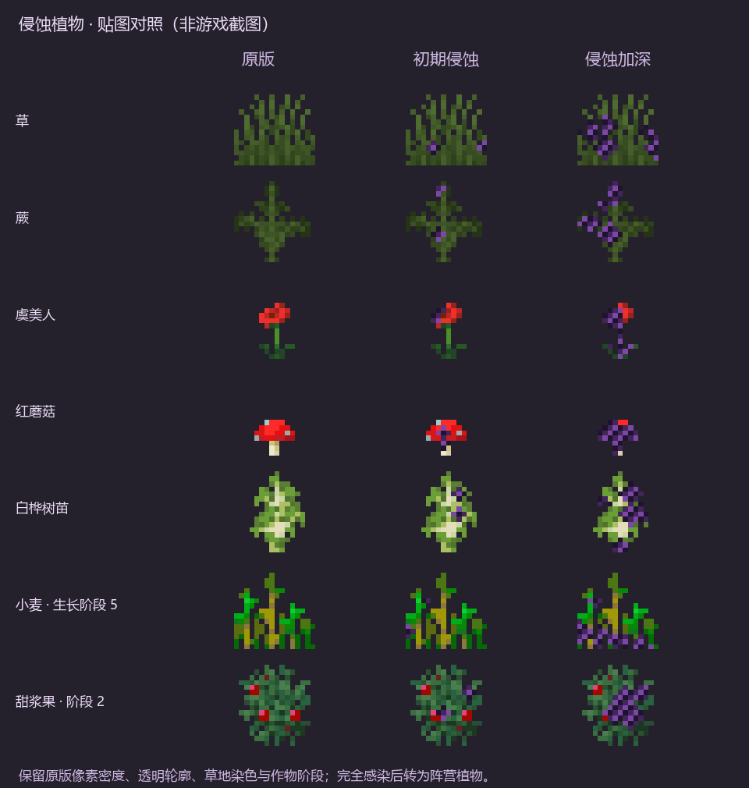
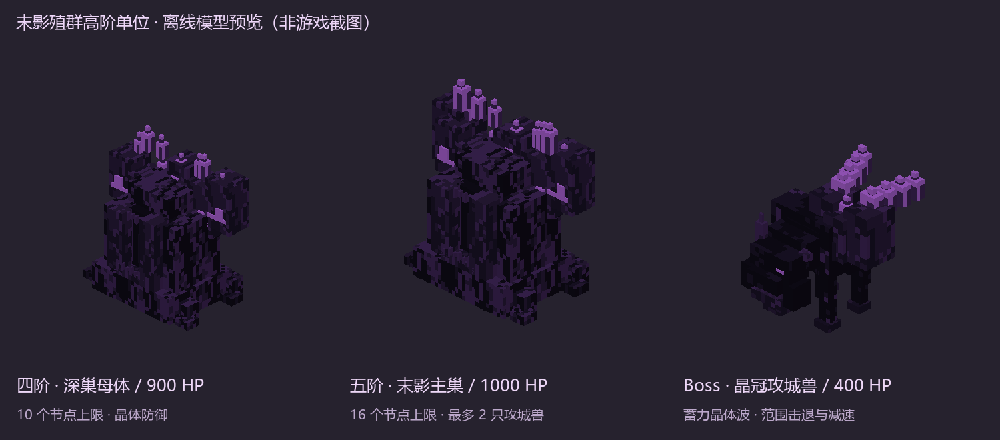

# 末影感染 · Ender Infection

Minecraft **1.20.1** 的末影感染阵营 Mod，使用 **Forge 47.3.12、GeckoLib 4.4.9 和 Java 17**。当前版本为 **0.2.1**。

## 内容

- 初期侵蚀与完全畸变两阶段生物，初期保留宿主原色。
- 五阶段母体、独立生物质储备、召唤与进化消费、濒死防御。
- 节点驱动的地形、树木与植物感染，子节点替换地表，土地养分逐渐衰减。
- 分队狩猎、阵营回防、目标搜索、蜘蛛攀爬与兵种战果反馈。
- 各畸变单位的晶刺技能；畸变骷髅使用魔法阵与水晶施法。
- 晶冠攻城兽、阵营粒子效果、掉落材料、共振晶刃与抑制晶粉。
- Blockbench 可编辑模型、贴图、骨骼动画，以及游戏使用的模型资源。

## 文件位置

| 目录 | 内容 |
|---|---|
| [ender_infection_colored](ender_infection_colored) | Forge / Java 完整工程 |
| [Java 源码](ender_infection_colored/src/main/java) | 实体、AI、扩张、技能与测试代码 |
| [运行时资源](ender_infection_colored/src/main/resources/assets/ender_infection) | 模型、动画、贴图、语言与特效资源 |
| [colored_units](colored_units) | Blockbench `.bbmodel` 与配套贴图 |
| [previews](previews) | 离线贴图和模型预览 |

## 编译与运行测试

安装 JDK 17 后，在工程目录执行：

```powershell
cd ender_infection_colored
.\gradlew.bat build
```

Linux / macOS 使用 `./gradlew build`。首次构建需要联网下载 Forge 与 GeckoLib 依赖。编译结果位于 `ender_infection_colored/build/libs/ender-infection-0.2.1.jar`。

启动游戏需要 Minecraft 1.20.1、Forge 和对应版本的 GeckoLib。把编译后的 Mod JAR 与 GeckoLib JAR 放入实例的 `mods` 文件夹。

运行隔离服务器测试：

```powershell
.\gradlew.bat runGameTestServer
```

测试会在工程 `build` 目录下创建新的测试世界。0.2.1 的本地构建记录为 **50 项必需 Forge GameTest 全部通过**；记录见 [verification/RESULTS.txt](ender_infection_colored/verification/RESULTS.txt)。客户端视觉、多人表现和长期平衡仍需游戏内验证。

## 玩法说明

- [植物侵蚀、地表节点与晶刺技能](ender_infection_colored/植物侵蚀与晶刺技能_0.2.1.md)
- [生态、五阶段母体、Boss、掉落与合成](ender_infection_colored/生态与高阶母体_0.2.0.md)

## 预览

以下为离线贴图、模型预览。




