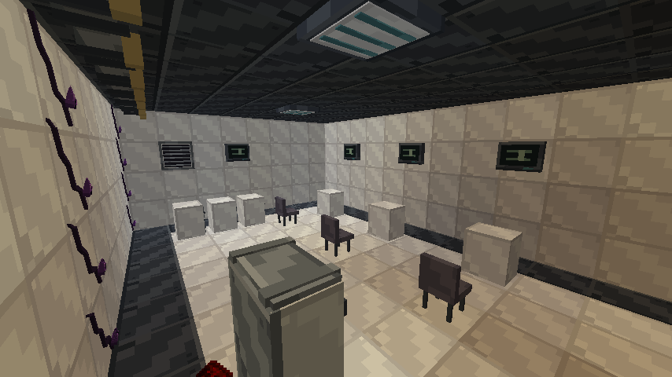
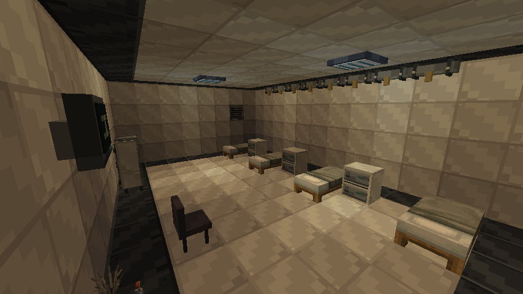

# 末影感染 · Ender Infection

Minecraft **1.20.1 / Forge 47.3.12 / GeckoLib 4.4.9 / Java 17** 阵营 Mod。当前开发版本：**0.11.0-alpha.5**。

感染从母体与扩张节点开始。每个母体拥有独立的生物质储备；召唤、进阶与节点扩张消费储备，土地收益随领土扩大而增加，重复收割同一片土地的收益逐渐下降。

## alpha.5 实验室房间重做

按用途重新布置 24 间房，分为后勤与控制、样本研究、医疗、动力与收容四层。病房使用成组床位与床头柜，培养室有玻璃隔间，控制室有操作席和监视器，档案室有书架与阅览台；机房、厨房、冷库、隔离室也分别布置。各室保留通行路线，并配置对应类别的战利品箱。

新增 10 种原创装饰方块：监视器、样本架、货架、管线、灯板、座椅、清洗槽、货箱、冷柜和地板格栅，附可编辑 `.bbmodel`、贴图、合成与掉落。实验室方块合计 38 种。入口补齐侧边与门楣，采用嵌入式灯板；打开门时门框仍有碰撞，梯子止于入口平台，内部三段楼梯留足净空。

对真菌 Mod 原始结构的逐格分析、观察与推断分开记录在 [房间参考与设计说明](docs/laboratory-room-reference.md)。本项目未复制它的结构或素材。下面是独立 Minecraft 测试世界中的实际截图：

| 控制室 | 病房 |
|---|---|
|  |  |

**已经放进旧存档的建筑不会自动重建。更新后请使用 `/enderlab research` 生成新实验室，或探索新生成的区块。** 原有实验室整栋/剖面 `.bbmodel` 是旧版设计示意；当前房间布局以原生 NBT 和 `tools/lab_rooms.py` 为准，新增 10 件摆件各有独立 Blockbench 原件。

## alpha.4 崩溃修复

修复实验室通风口、储柜、门、检修口、观察窗、工作台和手术台的空发光蒙版崩溃。无有效发光像素时跳过发光层；有效晶体发光效果保留。新增资源重载缓存清理，导出器与校验器拒绝空发光蒙版。

客户端验证现在实际执行 GeckoLib 发光纹理注册：33 张有效蒙版注册通过，7 种无发光设备被跳过。此前仅烘焙模型和贴图的检查未覆盖这条崩溃路径。

## 本轮接入

- 19 款怪物设计进入游戏：14 种新专职单位，以及重做的追猎者、棱骨术士、攻城兽、母体与灾变母体。灾变母体对应第五阶段，沿用母体阵营和储备。第一至第四阶段目前共用同一设计并逐级放大，外观区分主要来自体型。
- 新单位使用骨骼模型、逐面 UV、待机、移动、攻击、登场和死亡动画，攻击关键帧与服务端命中时机对应。
- 侦察者标记目标，搬运兽回收材料，晶盾卫士正面减伤，喷吐者发射带毒晶体，祭司治疗与减伤支援，孵化单位按母体储备付费并遵守人口上限。
- 2 套四件式护甲、4 种武器和 8 类掉落材料；包含合成、修理、耐久、冷却和晶刺弩弹药消耗。
- 14 类实验室构件，各有完整与侵蚀版本，共 28 个方块。门和储柜可以开合，培养舱有动态标本，手术台提供治疗，大型摆件占用对应空间。
- 原生四层研究实验室：32×26×28 格，24 个房间、楼梯与梯井、地表入口、战利品箱及有限额刷怪点。完整和剖面 `.bbmodel` 保留旧版建筑示意；本轮原生结构已重做房间布局。

## 单位

| 单位 | 主要作用 | 最低母体阶段 |
|---|---|---|
| 潜伏觅食虫 | 近战、传递目击目标 | 1 |
| 孢翼侦察者 | 飞行、目标标记与晶体攻击 | 2 |
| 晶背搬运兽 | 回收感染组织和浓缩生物质并运回母体 | 2 |
| 脉动孵化囊 | 固定孵化阵地，付费生产觅食虫 | 2 |
| 菌丝掘地者 | 近战与目标周围晶刺 | 3 |
| 寄生蛛母 | 近战、付费孵化小型蜘蛛 | 3 |
| 晶盾卫士 | 正面减伤、近战防守 | 3 |
| 裂喉喷吐者 | 带毒晶体投射物 | 3 |
| 跃刃伏击者 | 跃击 | 3 |
| 根刺炮台 | 固定远程晶刺阵地 | 3 |
| 共鸣祭司 | 支援治疗、抗性和晶体攻击 | 4 |
| 破城巨像 | 范围重击与晶刺 | 4 |
| 行巢巨蟹 | 巨型近战、付费孵化 | 5 |
| 深渊掘王 | 高生命值、远程晶刺法阵 | 5 |

专职单位复用狩猎、回防、母体归属和人口限制。低于 64 生物质时，母体优先使用原有低成本兵种；大型单位还需要足够的出生空间。

## 装备

| 物品 | 操作 |
|---|---|
| 棱晶长枪 | 左键近战；右键前方窄角度突刺 |
| 裂地战锤 | 左键近战；右键范围震击 |
| 晶刺弩 | 按住右键至少 15 tick 后松开；消耗 1 个晶体碎片，发射 3 枚晶体 |
| 共鸣法杖 | 右键发射魔法晶体并显示法阵 |
| 晶壳轻甲 | 四件套持续清除本 Mod 的末影侵蚀效果 |
| 母巢重甲 | 四件套濒危时提供临时吸收与本次减伤，20 秒冷却 |

## 实验室与调试指令

需要开启作弊或拥有管理员权限。

```mcfunction
/enderlab research
```

在玩家东侧 40 格处放置四层研究实验室，底层低于玩家 20 格，聊天栏会显示底层坐标。入口位于底层上方 21 格。**放置会替换对应空间的方块，请在测试世界或空旷地点使用。**

```mcfunction
/locate structure ender_infection:research_lab
/enderlab hospital
/enderlab prison
/give @s ender_infection:infected_shield_sentinel_spawn_egg
/give @s ender_infection:resonance_staff
```

研究实验室在蘑菇岛、黑森林、沼泽的新区块中尝试自然生成，使用原生结构集的 32 / 10 区块间距设置；并非每个候选位置都符合群系。医院和牢房仍使用已有的小型遗迹布局。

## 安装与 E 盘位置

本机启动入口为 `E:\mc\启动MC.cmd`，Prism Launcher 与游戏实例位于 `E:\mc\Minecraft1201`。账号、存档和启动器数据属于本机文件，不进入 Git 仓库。

编译后的 `ender-infection-0.11.0-alpha.5.jar` 与 `geckolib-forge-1.20.1-4.4.9.jar` 放入同一个 Forge 1.20.1 实例的 `mods` 目录。更新时只保留一个版本的 Ender Infection JAR。模型改变需要重新启动游戏。

## 工程与可编辑资源

| 位置 | 内容 |
|---|---|
| [ender_infection_colored](ender_infection_colored) | Forge / Java 工程 |
| [Java 源码](ender_infection_colored/src/main/java/dev/hui/enderinfection) | 实体、AI、生物质、战斗、实验室与测试 |
| [游戏资源](ender_infection_colored/src/main/resources/assets/ender_infection) | Gecko 模型、动画、贴图、烘焙模型与语言 |
| [结构与配方](ender_infection_colored/src/main/resources/data/ender_infection) | 实验室 NBT、世界生成、掉落和合成 |
| [Blockbench 设计包](colored_units/design_pack_2026-11-02_v2) | 63 个可编辑模型、贴图与设计源脚本 |
| [新增实验室摆件](colored_units/lab_details_v3) | 10 件原创房间细节模型与贴图 |
| [转换工具](tools) | 导出游戏资源、生成结构与验证资源 |
| [验证结果](ender_infection_colored/verification/RESULTS.txt) | 实际构建、GameTest 和客户端加载记录 |

Blockbench 原件保留完整的逐面 UV。墙地使用 Forge 烘焙模型，大型实验设备使用 GeckoLib 方块实体；实验室整栋场景转换为原生方块结构。

本轮静态验证覆盖 24 间不同布局、战利品箱可达性、入口和楼梯净空；独立客户端已检查入口开合及 4 间代表房间的实际画面。完整 GameTest 与资源加载结果见验证记录。

## 构建与验证

使用 JDK 17：

```powershell
cd ender_infection_colored
.\gradlew.bat build
.\gradlew.bat runGameTestServer
.\gradlew.bat runClient -PdesignSmoke
.\gradlew.bat runClient -PlabVisualCheck
```

首次构建需要联网；已有依赖缓存可添加 `--offline`。产物位于 `ender_infection_colored/build/libs`。GameTest 使用 `build` 下的新世界；客户端资源检查使用独立开发目录。

重新导出模型和数据需要 Python、Pillow 与 NumPy：

```powershell
python tools/export_design_assets.py
python tools/build_design_data.py
python tools/validate_design_assets.py
python tools/validate_laboratory.py
```

项目使用 **qegg** 管理变更记录和发布验证：

```powershell
qegg check
qegg verify
qegg plan
```

变更记录位于 [.changes](.changes)，验证命令在 [.quailegg.toml](.quailegg.toml)。当前版本仍处于 alpha，长期平衡与多人表现需要继续实玩验证。
