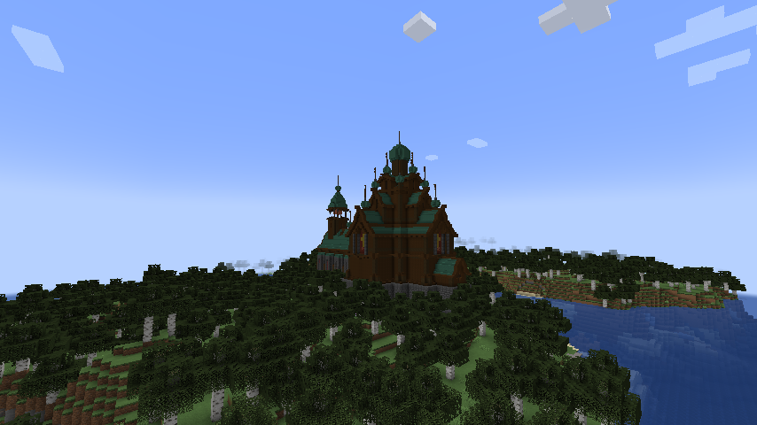
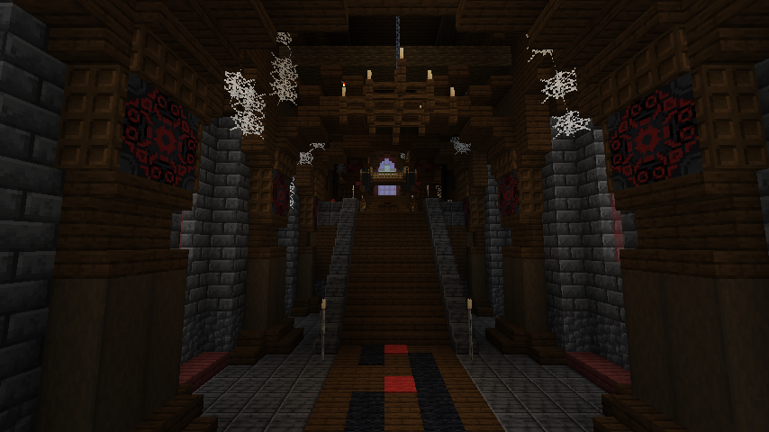

# 末影感染 · Ender Infection

末影感染是 Minecraft 阵营 Mod。当前稳定版本为 **0.11.0（Forge 1.20.1）**；最新预发布版本为 **0.12.0-alpha.4（Forge 1.20.1 / NeoForge 1.21.1，2026-11-05）**。

**v0.12.0-alpha.4** 同时提供 **Forge 1.20.1 / Java 17** 与 **NeoForge 1.21.1 / Java 21**。安装包与验证记录见 [alpha.4 发布页](https://github.com/fl749731-lab/ender-infection/releases/tag/v0.12.0-alpha.4)，维护流程见 [双版本维护](docs/dual-version-maintenance.md)。[alpha.3 发布页](https://github.com/fl749731-lab/ender-infection/releases/tag/v0.12.0-alpha.3)保留上一预发布版与运行实景，[alpha.2 发布页](https://github.com/fl749731-lab/ender-infection/releases/tag/v0.12.0-alpha.2)保留历史设计附件。

两版继续共用模型、贴图和研究所 API。alpha.2 引入的房间注册、连接器、模板预览、显式放置和设备交互 API，以及 [独立附属 Mod 示例](examples/institute-addon/README.md) 均保留；旧版 `0.12.0-alpha.1` 不含该 API。

alpha.3 引入的中央研究所实际游戏建筑继续保留：地上三层、地下三层，共 48 间内饰房间，支持自然生成和管理员分区块施工。使用方法见 [中央研究所](docs/central-institute.md)，双版截图见 [运行实景](previews/central-institute-runtime/README.md)，历史 [alpha.3 实景图包](https://github.com/fl749731-lab/ender-infection/releases/download/v0.12.0-alpha.3/central-institute-runtime-0.12.0-alpha.3.zip)继续可下载。alpha.4 在新布局中追加研究所供电与样本研究；收容事故事件和研究所 Boss 战仍未实现。

alpha.2 的设计资料继续保留：[完整图包](https://github.com/fl749731-lab/ender-infection/releases/download/v0.12.0-alpha.2/central-research-institute-interiors-v01.zip)、[73 页 PDF](https://github.com/fl749731-lab/ender-infection/releases/download/v0.12.0-alpha.2/central-institute-interior-atlas-v01.pdf)。解压后打开 `index.html` 浏览逐格坐标与材料清单；这些历史附件不等同于 alpha.2 JAR 已包含整栋建筑。

感染从母体与扩张节点开始。每个母体拥有独立的生物质储备；召唤、进阶与节点扩张消费储备，土地收益随领土扩大而增加，重复收割同一片土地的收益逐渐下降。

## v0.12.0-alpha.4 · 2026-11-05

本版新增研究所修复、两区供电、门禁卡、显微分析、离心分离与一次性核心档案任务，并补充医疗床和等候沙发。修复消耗保险丝 ×1、铜锭 ×4、红石 ×4；修复后在配电控制器主手普通右键切换服务区，主手空手潜行右键切换收容区。新布局接入 881 盏分区灯、40 个受管门及 42 台加工设备。玩法适用于新生成或新施工的 v3 布局，已有 alpha.3 建筑保持原样；收容事故事件和 Boss 战继续待做。操作步骤、适用范围和验证命令见[研究所供电与样本研究](docs/institute-operations.md)，新增附属接口见[研究所 API](docs/institute-api.md)。当前附属源码示例使用新增接口，需要 alpha.4；已有 alpha.2 API v1 附属保持兼容。

本轮[可编辑家具模型](colored_units/institute_furniture_v4)包含 25 份 `.bbmodel` 与配套贴图，其中新增发电机、配电控制器、研究终端、档案终端、医疗床床尾、医疗床床头和等候沙发 7 份模型；模型附件见 [alpha.4 发布页](https://github.com/fl749731-lab/ender-infection/releases/tag/v0.12.0-alpha.4)。

<!-- alpha4-validation -->
alpha.4 已完成完整双版干净构建与 16 组原生测试，共 139 项必需测试通过（含两版附属各 2 项）；两版独立功能场景完成 20 张真实交互截图验收。截图与验证范围见[功能验收记录](previews/institute-operations-alpha4/README.md)。最新公开预发布版为 [alpha.4](https://github.com/fl749731-lab/ender-infection/releases/tag/v0.12.0-alpha.4)，稳定版保持 0.11.0。

## v0.12.0-alpha.3

- 中央研究所占地 120×104，建筑包围盒高 55 格；48 间房各有内饰与分类补给，双楼梯、货梯和中庭连桥连接六层。
- 13 类储物家具提供真实 27 格箱子界面，包括柜子、工作台抽屉、冷柜、货箱、货架、洗手盆下柜及新增展示柜、低温柜、机架、控制台和推车。中央模板含 1417 个分类战利品储柜，六种旧小站模板合计 368 个；玩家自行放置为空，生成物资领取后不再刷新。
- 补充可开合隔帘、显微镜、离心机、冷却泵和工作灯，按房间用途调整设备与内饰；五色细墙带、房间标识及可见柜门/抽屉纠正与设计图的差异。
- E5 培养舱阵列恢复六座大型培养舱；A3 医疗观察室配置四张观察床，设备与床边保留通路。
- 在合适的主世界新区块自然生成；可用 `/enderinstitute previewcentral` 检查场地，再用 `/enderinstitute build` 分区块施工。旧小型实验室、导入建筑与已有存档中的建筑保留。
- 两条入口道路适配不超过 8 格的地形高差；修正门口与补给桶通路，保留室外原地形及既有容器保护。
- 59 处紫晶表面加入实际补光，保留相邻空气与长芽空间；原生光照验收要求暴露面方块光照至少为 12。

本次发行执行完整双版本干净构建，实际 115 项必需原生测试全部通过；四个原生客户端完成 150 张截图验收：122 张中央研究所实景，加 28 张真实库存界面及开柜模型。最终 JAR 校验和、布局与图像 SHA256 见发布验证清单。

## v0.11.0 稳定版

- 14 种新怪物通过 Blockbench MCP 细化模型、骨骼和动画，游戏资源与可编辑原件同步。
- 补齐新旧怪物及母体各阶段的紫晶自发光，包含晶体暗面与尖端。
- 修复蛛母接近目标后不出手、搬运兽被击退后放弃反击的问题；21 项原生 Forge AI 回归通过，覆盖新单位对原版动物和敌对怪物的战斗与孵化行为。
- 收录本轮晶矿、装备、陨石开局、连通扩张与实验室更新，完整变更见 [更新日志](CHANGELOG.md)。

下载 [v0.11.0](https://github.com/fl749731-lab/ender-infection/releases/tag/v0.11.0) 的 JAR，替换旧版后重启游戏。仅保留一个末影感染 JAR，并同时安装下面列出的 GeckoLib 前置。

## 必装前置：GeckoLib

**客户端和服务端都需要安装与 Minecraft、加载器匹配的 GeckoLib。**

| Minecraft / 加载器 | Java | GeckoLib 要求 | 已测试 GeckoLib | 下载或说明 |
|---|---|---|---|---|
| **1.20.1 / Forge 47.3.12** | **17** | `4.4.9 ≤ 版本 < 5` | **4.4.9** | [GeckoLib 4.4.9（Forge 1.20.1）](https://modrinth.com/mod/geckolib/version/RBA7lJaW) |
| **1.21.1 / NeoForge 21.1.265** | **21** | `4.9.3 ≤ 版本 < 5` | **4.9.3** | [NeoForge 构建说明](ender_infection_neoforge/README.md) |

将对应平台的 GeckoLib 与本 Mod JAR 放入同一个实例的 `mods` 文件夹；专用服务器也放入其 `mods` 文件夹。GeckoLib 需单独下载，未打包进本 Mod。缺少前置或版本不满足要求时，加载器会提示依赖错误。Forge 与 NeoForge 的 JAR 分别安装到各自版本的实例。

## 晶体装备与开局陨石

共鸣晶、余烬晶和虚空晶各有四件护甲、镐、斧、铲、锄和剑，共 27 件。用对应晶体按原版装备形状合成，工具和剑另用木棍。铁砧可用对应晶体修理。创造栏和物品提示中能看到三套装备及其能力。三套护甲都有随手臂摆动的立体肩甲、盔沿和护靴。共鸣甲的背晶向两侧分叉，余烬甲用双晶排气座，虚空甲有外伸肩刃和中央青色长晶。

| 系列 | 四件套护甲 | 工具 | 剑 |
|---|---|---|---|
| 共鸣晶 | 来自本 Mod 感染单位的伤害降低 20% | 使用适配工具采掘矿石，或站在感染地面上采掘时，速度提高 35% | 对感染单位额外造成 25% 伤害并标记 3 秒 |
| 余烬晶 | 火焰类伤害降低 40% | 在下界使用适配工具时，速度提高 25% | 命中点燃目标 3 秒 |
| 虚空晶 | 摔落伤害减半，弹射物伤害降低 20% | 空中使用适配工具时，采掘速度乘以 3 | 右键抛出末影珍珠，消耗 2 点耐久，冷却 12 秒，按珍珠规则传送 |

共鸣晶与余烬晶工具采用铁镐级采集等级，虚空晶工具采用钻石镐级采集等级。三套的材料来自相应矿石，共鸣系列使用共鸣碎片。

新世界首位玩家进入主世界约 5 秒后，聊天栏提示落点，紫色陨石从附近天空下坠。约 2.2 秒后，陨石以威力 5.5 的爆炸撞击地面，伤害并击退附近生物。在允许地形破坏时，冲击会在自然地面炸出陨石坑，随后优先在坑内生成第一阶段母体。地形破坏遵守 `mobGriefing`。事件保存在世界数据中，飞行和撞击状态会随读档继续。和平难度期间暂停。

可移动的侵蚀和畸变单位会在安全落点之间闪现，追击可见目标或躲避弹射物。冷却中也会免疫箭矢、三叉戟等弹射物伤害。母体、孵化囊和根刺炮台保持扎根，享有同样的弹射物免疫。母体目击被闪避的弹射攻击时仍会学习远程战术。

进度界面新增「末影感染」页，共九项，涵盖见证陨石坠落、取得三种晶体、集齐三套护甲及击杀母体。

## alpha.8 晶矿

| 矿石 | 矿脉起始高度 | 最低镐等级 | 用途 |
|---|---|---|---|
| 共鸣晶矿、深层共鸣晶矿 | 主世界 Y -56 到 48，矿脉在 Y -4 附近更常见 | 铁镐 | 掉落共鸣碎片，用作晶刺弩弹药和抑制粉原料 |
| 余烬晶矿 | 下界地狱岩中，Y 20 到 100 | 铁镐 | 用余烬晶体替代灯板配方的萤石粉，每次做出两块实验室灯板 |
| 虚空晶矿 | 末地外岛高地和中地，Y 32 到 72 | 钻石镐 | 一颗虚空晶体和一个雪球做出六份抑制粉 |

矿脉随新区块自然生成。矿石支持时运和精准采集，普通开采会掉落经验。四种矿石方块和两种晶体可在「末影感染」创造栏找到。

## alpha.7：连通扩张与高处蔓延

节点按生物质储备计时扩张，修复之前每个 tick 都扫描和扣费的问题。连续坡面与裸露崖面都能向上感染；搜索高度随节点范围增长，高台也能成为子节点的落脚点。新前哨按**尚未被节点覆盖的可感染地形和剩余肥力**评分，扣除母节点本身的覆盖，优先向新领土推进。年轻节点可沿相连的旧感染带向外增长，避免被母节点的覆盖困住。

地表优先于树冠维护；前方无可感染地形时不购买空半径。前哨被毁后可付费补建，未加载的子节点保留记录。母体随节点数量保留 16～64 生物质作为扩张周转金；升级也要留下这笔钱。高处感染领土计入收益，土地衰竭与各母体独立储备规则继续保留。

机制、费用、限制和测试方法见 [扩张说明](docs/expansion.md)。使用 `/enderstrategy` 查看附近节点的搜索高度、扩张轮次与下一轮等待时间。

## alpha.6：区块加载修复与导入建筑

修复靠近自然实验室时远处地形空白的问题：大型设备的占位方块在灯光线程读取邻区块，导致区块生成与灯光互相等待。现在光照路径使用固定透明形状，碰撞仍跟随已加载的设备根方块。修复前已在独立噪声世界复现，修复后重新检查原生自然生成。

打开门后仍无法通过的问题也已修复：上下门框从 1.7 像素缩到 1 像素，模型与碰撞同步，净高 **1.875 格**。站立玩家实际移动验证覆盖完整/侵蚀门的四种朝向和六类旧入口。

按用户选择，建筑改用真实的上游结构文件。保留原体量与构造，转换方块和容器；不把导入建筑声明为原创。源文件、映射脚本、作者和许可均保留在 [third_party/architecture](third_party/architecture/README.md)。

| 建筑 | 来源 | 大小（宽×高×长） | 指令 |
|---|---|---|---|
| 废弃工业实验室 | HBM | 19×17×21 | `/enderbuild hbm_laboratory` |
| 废弃工厂 | HBM | 38×41×19 | `/enderbuild hbm_factory` |
| 极地科考站 | HBM | 38×14×24 | `/enderbuild hbm_arctic` |
| 废弃教堂 | Church of Sin | 37×58×70 | `/enderbuild church` |





四套建筑跳过水域和大于 5 格高差的陡坡，分别在对应群系尝试自然生成，完整群系和转换说明见 [导入建筑说明](docs/imported-buildings.md)。旧方盒布局已停止自然生成，原有六套 `/enderlab` 调试布局与旧存档中的建筑保留。

手动放置在玩家东侧 64 格开始，会替换建筑空间中的原有方块。每两个 tick 处理一个区块，进度保存到存档；`/enderbuild status` 查看进度，`/enderbuild cancel` 停止后续放置。请在测试世界或空旷区域使用。

**Lua Lab** 已准备本地 `.litematic` 转换与加载入口，当前尚未取得作者下载文件，因此没有打包或声称安装了这套园区。导入方法见 [说明](docs/imported-buildings.md#lua-lab)。其转换件不随公开 JAR 分发。

旧调试布局增加了双向升降平台和金属检修梯，保留 30 种房间源布局、56 个功能区和 9 处破损区域。平台通过玩家传送连接楼层；右键上行、潜行右键下行，顶层右键下行，目标落点堵塞时拒绝传送。已有旧建筑不会自动重建。

## alpha.4 崩溃修复

修复实验室通风口、储柜、门、检修口、观察窗、工作台和手术台的空发光蒙版崩溃。无有效发光像素时跳过发光层；有效晶体发光效果保留。新增资源重载缓存清理，导出器与校验器拒绝空发光蒙版。

客户端验证现在实际执行 GeckoLib 发光纹理注册：33 张有效蒙版注册通过，7 种无发光设备被跳过。此前仅烘焙模型和贴图的检查未覆盖这条崩溃路径。

## 本轮接入

- 19 款怪物设计进入游戏：14 种新专职单位，以及重做的追猎者、棱骨术士、攻城兽、母体与灾变母体。灾变母体对应第五阶段，沿用母体阵营和储备。第一至第四阶段目前共用同一设计并逐级放大，外观区分主要来自体型。
- 新单位使用骨骼模型、逐面 UV、待机、移动、攻击、登场和死亡动画，攻击关键帧与服务端命中时机对应。
- 侦察者标记目标，搬运兽回收材料，晶盾卫士正面减伤，喷吐者发射带毒晶体，祭司治疗与减伤支援，孵化单位按母体储备付费并遵守人口上限。
- 2 套四件式护甲、4 种武器和 8 类掉落材料；包含合成、修理、耐久、冷却和晶刺弩弹药消耗。
- 14 类实验室构件的完整/侵蚀版本，加上 12 件功能与装饰摆件，共 40 个方块。门和储柜可开合，培养舱有动态标本，手术台提供治疗，升降平台连接楼层。
- 四套署名导入建筑进入自然生成；旧六套实验室调试布局保留大厅、中庭、连桥、竖井、破损区域、升降平台和分类补给箱。

## 单位

| 单位 | 主要作用 | 最低母体阶段 |
|---|---|---|
| 潜伏觅食虫 | 优先标记附近猎物，受重伤时拉开距离 | 1 |
| 孢翼侦察者 | 在猎物上方绕飞，标记后从空中发射晶刺 | 2 |
| 晶背搬运兽 | 主动回收残骸，绕路将生物质交给所属母体 | 2 |
| 脉动孵化囊 | 固定孵化阵地，付费生产觅食虫 | 2 |
| 菌丝掘地者 | 沿地面突进，在目标附近唤出晶刺 | 3 |
| 寄生蛛母 | 守在孵化地附近，消耗母体生物质孵化幼蛛 | 3 |
| 晶盾卫士 | 默认驻守，面向攻击者减伤并挡在前线 | 3 |
| 裂喉喷吐者 | 主动拉开射距，避开友军后喷吐毒晶 | 3 |
| 跃刃伏击者 | 蓄力后跨过间隔，贴身挥出双镰 | 3 |
| 根刺炮台 | 固定远程晶刺阵地 | 3 |
| 共鸣祭司 | 跟随交战友军，在后排治疗和施法 | 4 |
| 破城巨像 | 沿蓄力方向冲撞，接范围重击和晶刺 | 4 |
| 行巢巨蟹 | 在近处交战，消耗生物质孵化护卫 | 5 |
| 深渊掘王 | 维持距离，以远程晶刺法阵封锁地面 | 5 |

14 种单位按设计图重建主体轮廓：低伏虫体、横向宽翼、鼓胀货囊、外张八足与吊卵、低垂三卵孵化腔、分离双喉囊、弧形长镰和拱尾、三联晶矛、根须裙摆与分层巨拳。行巢巨蟹改为隆起叠甲和粗壮外张步足，深渊掘王改为连续弯曲的长躯与开放环形口器。骨甲、软组织和紫晶分层着色，Blockbench 模型、UV、动画与游戏资源同步导出。[生态单位、战斗单位与巨兽的原始设计图](previews/ender_faction_concepts_2026-11-02/)。

新增单位、重做怪物、旧感染生物与母体各阶段，紫晶的暗面和尖端均纳入自发光蒙版，暗处保留晶体颜色与棱面层次，飞行晶刺也保持自发光。可用 `gradlew.bat runClient -PcrystalGlowCheck` 在独立暗室生成 34 个实体的正反面截图，检查天空光和方块光均为 0 时的效果。

单位分别选择接敌和支援方式，并响应所属母体的回防命令。低于 64 生物质时，母体优先使用原有低成本兵种；大型单位还需要足够的出生空间。

## 装备

| 物品 | 操作 |
|---|---|
| 棱晶长枪 | 左键近战；右键前方窄角度突刺 |
| 裂地战锤 | 左键近战；右键范围震击 |
| 晶刺弩 | 按住右键至少 15 tick 后松开；消耗 1 个晶体碎片，发射 3 枚晶体 |
| 共鸣法杖 | 右键发射魔法晶体并显示法阵 |
| 晶壳轻甲 | 四件套持续清除本 Mod 的末影侵蚀效果 |
| 母巢重甲 | 四件套濒危时提供临时吸收与本次减伤，20 秒冷却 |

## 建筑调试指令

需要开启作弊或拥有管理员权限。手动放置会替换对应区域的方块。

```mcfunction
/enderbuild list
/enderbuild hbm_laboratory
/enderbuild hbm_factory
/enderbuild hbm_arctic
/enderbuild church
/enderbuild status
/locate structure ender_infection:imported/church
```

新建筑使用原生结构集，40 / 14 区块间距；群系条件仍需满足。已生成的旧区块不会新增建筑。

旧实验室调试命令仍可用：`/enderlab research|swamp|forest|medical|snow|badlands|auto`。其聊天栏给出入口坐标。`hospital` 和 `prison` 分别兼容映射到旧医疗站和采掘设施。

## 安装与 E 盘位置

本机保留的 Forge 1.20.1 启动入口为 `E:\mc\启动MC.cmd`，Prism Launcher 与原游戏实例位于 `E:\mc\Minecraft1201`。NeoForge 1.21.1 使用另建的对应版本实例。账号、存档和启动器数据属于本机文件，不进入 Git 仓库。

Forge 1.20.1 使用 `ender-infection-0.12.0-alpha.4.jar` 和对应的 GeckoLib；NeoForge 1.21.1 使用 `ender-infection-neoforge-1.21.1-0.12.0-alpha.4.jar` 和对应的 GeckoLib。更新时只保留当前实例需要的一份 Ender Infection JAR，并重新启动游戏。两版安装包分别使用，不转换现有 1.20.1 存档；中央研究所自然生成只出现在尚未探索的新区块，已有 alpha.3 建筑不会自动重建或绑定新任务。

## 工程与可编辑资源

| 位置 | 内容 |
|---|---|
| [ender_infection_colored](ender_infection_colored) | Forge / Java 工程 |
| [ender_infection_neoforge](ender_infection_neoforge) | NeoForge 1.21.1 / Java 21 工程 |
| [公共 API](common/src/main/java/dev/hui/enderinfection/api/institute) | 两版共用的房间、连接器与设备接口 |
| [附属 Mod 示例](examples/institute-addon) | 两版独立工程、交互控制台和房间模板 |
| [Java 源码](ender_infection_colored/src/main/java/dev/hui/enderinfection) | 实体、AI、生物质、战斗、实验室与测试 |
| [游戏资源](ender_infection_colored/src/main/resources/assets/ender_infection) | Gecko 模型、动画、贴图、烘焙模型与语言 |
| [结构与配方](ender_infection_colored/src/main/resources/data/ender_infection) | 实验室 NBT、世界生成、掉落和合成 |
| [Blockbench 设计包](colored_units/design_pack_2026-11-02_v2) | 63 个可编辑模型、贴图与设计源脚本 |
| [新增实验室摆件](colored_units/lab_details_v3) | 12 件原创功能与细节模型、贴图 |
| [研究所家具模型](colored_units/institute_furniture_v4) | 25 份可编辑家具模型、逐面 UV 与贴图，含 alpha.4 新增的 7 份模型 |
| [转换工具](tools) | 导出游戏资源、生成结构与验证资源 |
| [验证结果](ender_infection_colored/verification/RESULTS.txt) | 实际构建、GameTest 和客户端加载记录 |

Blockbench 原件保留完整的逐面 UV。墙地使用 Forge 烘焙模型，大型实验设备使用 GeckoLib 方块实体；实验室整栋场景转换为原生方块结构。

运行 gradlew.bat runClient -PcrystalCheck 可在隔离世界生成三套护甲的正反面和 14 种单位的实机截图。运行 gradlew.bat runGameTestServer -PaiChecks 可验证 14 种新单位的自主战斗与孵化：战斗单位自行选中原版动物、造成伤害并转向原版敌对怪物，同时覆盖侦察标记、搬运入账、跳袭和喷吐距离。历次记录见 [RESULTS.txt](ender_infection_colored/verification/RESULTS.txt)。

这 14 种怪物的正式原件已由 Blockbench MCP 编辑并保存为 BB5，位于设计包 `monsters/`。`python tools/rebuild_creature_silhouettes.py --preview` 从已保存的原件导出游戏资源及离线预览，保留 MCP 对几何和骨骼的修改；只有显式传入 `--regenerate` 才会用生成模板覆盖原件。`source/concept_*.py` 保留基础造型模板，最终原件以 `monsters/*.bbmodel` 为准。`gradlew.bat runClient -PconceptCheck` 在独立隐藏客户端生成正面、背面、蓄力和命中姿态截图，取景范围由实际几何计算；可用 `-PconceptSubjects=walking_nest,burrow_king` 选择检查对象。

本机已接入第三方 [Blockbench MCP v1.10.1](https://github.com/jasonjgardner/blockbench-mcp-plugin/releases/tag/v1.10.1)，地址为 `http://127.0.0.1:3000/bb-mcp`，使用时保持 Blockbench 开启。`python tools/blockbench-mcp/review_models.py --revision review-name` 通过 MCP 读取真实模型、拍摄三面并采样行走、蓄力、命中动画，结果存入 `previews/blockbench-mcp-2026-11-03/review-name/`。新路径副本避免编辑器复用旧标签页；脚本不保存模型改动。插件下载校验与连接记录见 `tools/blockbench-mcp/README.txt` 和 `ender_infection_colored/verification/blockbench_mcp.json`。

## 构建与验证

使用 JDK 17：

```powershell
cd ender_infection_colored
.\gradlew.bat build
.\gradlew.bat runGameTestServer
.\gradlew.bat runGameTestServer -PexpansionChecks
.\gradlew.bat runGameTestServer -PoreChecks
.\gradlew.bat runClient -PdesignSmoke
.\gradlew.bat runClient -ParchitectureCheck
.\gradlew.bat runClient -PnaturalLabCheck -PnaturalBiome=birch_forest -PnaturalBuilding=imported/church
```

首次构建需要联网；已有依赖缓存可添加 `--offline`。产物位于 `ender_infection_colored/build/libs`。GameTest 使用 `build` 下的新世界；客户端资源检查使用独立开发目录。

重新导出模型和数据需要 Python、Pillow 与 NumPy：

```powershell
python tools/export_design_assets.py
python tools/build_design_data.py
python tools/import_architecture.py
python tools/validate_design_assets.py
python tools/validate_laboratory.py
```

项目使用 **qegg** 管理变更记录和发布验证：

```powershell
qegg check
qegg verify
qegg plan
```

变更记录位于 [.changes](.changes)，验证命令在 [.quailegg.toml](.quailegg.toml)。当前版本仍处于 alpha，长期平衡与多人表现需要继续实玩验证。
