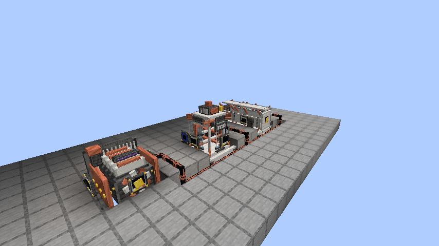
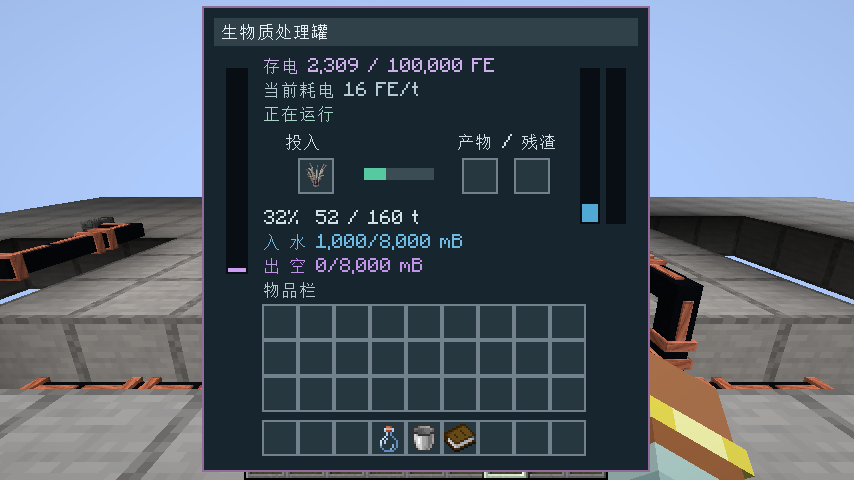

首次发布独立科技附属“末影感染：共振工业”0.1.0-alpha.1，提供 Forge Minecraft 1.20.1 / Java 17 和 NeoForge Minecraft 1.21.1 / Java 21 两份 JAR。安装时还需要对应版本的末影感染核心及 GeckoLib；推荐搭配核心 0.12.0-alpha.5。

加入燃料发电机（3×3×3）、生物质处理罐（3×4×3）、工业离心阵列（3×3×5），以及真实 FE 电缆、储能箱、流体管、储液罐、取水泵、物品端口、蓝图、装配扳手和逐层手册。感染材料加水制成浆液，再离心得到分离试剂或纯化组织；提供机器、配方和燃料注册 API。

成形外观采用发动机、立式搅拌罐和卧式离心鼓，补齐散热片、支架、电机、观察窗及端口。电缆采用细绝缘铜芯，仅向实际邻接方向连接。面板分别显示存电、当前发电或耗电、燃料剩余秒数、双储液名称及容量、加工百分比和等待原因。

煤炭与木炭每个总计 102,400 FE；待机耗电为 0，储能满时暂停燃烧。实际燃尽测试后继续检查 200 tick，确认没有新增电量。双版各 12 项附属原生测试、各 3 次真实服务器重启／区块卸载验收和各 12 张客户端截图通过。发布附件包含两份 JAR、图纸与实景指南、验证清单及 SHA256。

下载时按 Minecraft 和加载器选择一个附属 JAR。图纸与图片在 guide ZIP 内；本次仍需手动搭建，工业附楼、灭菌、合金和裂隙能源留待后续版本。

