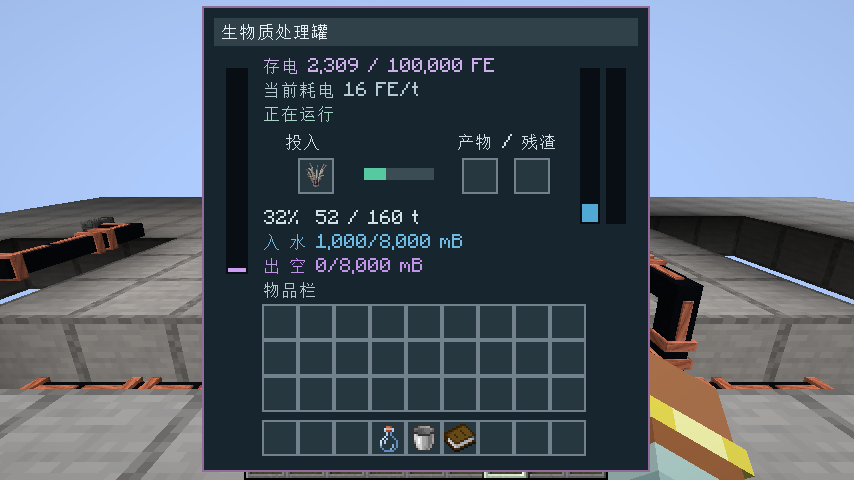
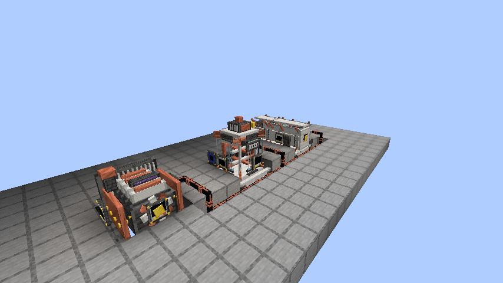
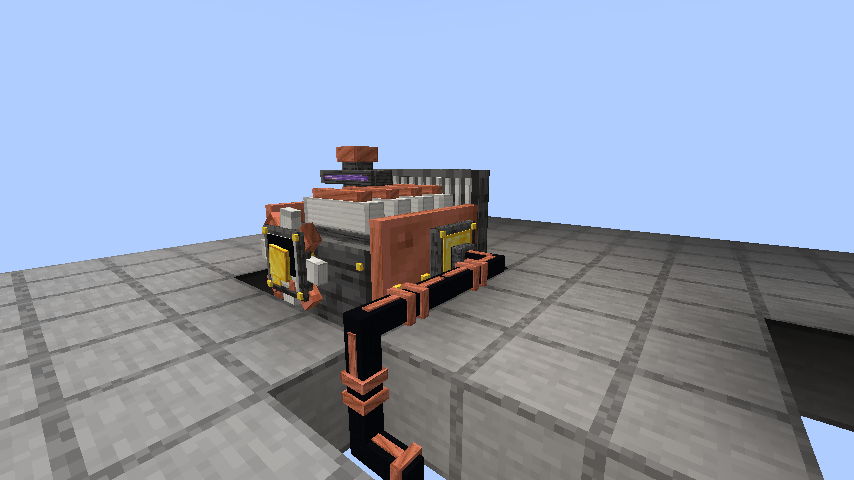

# 机器面板与用电说明

面板将“储存了多少”和“每 tick 变化多少”分开显示。**FE 是电量，FE/t 是功率**；正常游戏速度下每秒 20 tick。

| 显示 | 含义 |
|---|---|
| 存电 18,210 / 100,000 FE | 控制器当前缓冲与容量；左侧紫色条对应此比例 |
| 当前发电 64 FE/t | 发电机上一工作 tick 的实际产量；停机或暂停时为 0 |
| 当前耗电 16 / 24 FE/t | 处理罐／离心阵列正在加工的实际用电；等待时为 0 |
| 剩余燃烧 37.5 秒 | 已投入燃料还可发电的时间；储能满时保留这段时间 |
| 入 水 1,000 / 8,000 mB | 输入储液区的名称、当前量、容量；1,000 mB 为一桶 |
| 出 浆液 1,000 / 8,000 mB | 输出储液区，独立于输入储液区；右侧两条分别显示两区液位 |
| 31%　51 / 160 t | 本批加工进度与已进行／总 tick；未开始时显示等待说明 |

材料与液体在本批完成时一起扣除，制作过程中仍能看到它们。物品槽下方的绿色条对应加工进度。

## 为什么一块煤后还会有电

煤炭或木炭每个可发电 **64 × 1600 = 102,400 FE**，以正常速度持续燃烧 80 秒。浓缩生物质为 51,200 FE，燃料残渣为 25,600 FE。

机器没有待机耗电；加工材料不足时停止消耗，电缆与控制器中的存电会保存下来。发电机储能不足以容纳下一次 64 FE 时，显示“储能已满，燃烧暂停”，已投入的燃料时间也暂停。接入正在加工的负载、腾出空间后才继续发电。

处理罐制一桶浆液消耗 2,560 FE，离心制一份试剂消耗 4,800 FE，整条生产线一批合计 7,360 FE。一块煤可支持 13 个完整批次并有余电，因此几次加工不会把它耗完。

原生测试会从真实能源接口持续取电，核对一块煤累计输出恰好 102,400 FE；燃尽后再检查 200 tick，确认没有新增电量，面板功率和燃料计数均归零。

## 运行画面

图片由独立验收客户端运行生成，未经像素修改。两版各 12 张原图、三种逐层图纸和离线浏览页见 [alpha.1 图纸与实景指南](https://github.com/fl749731-lab/ender-infection/releases/download/resonant-industry-v0.1.0-alpha.1/resonant-industry-guide-0.1.0-alpha.1.zip)。
