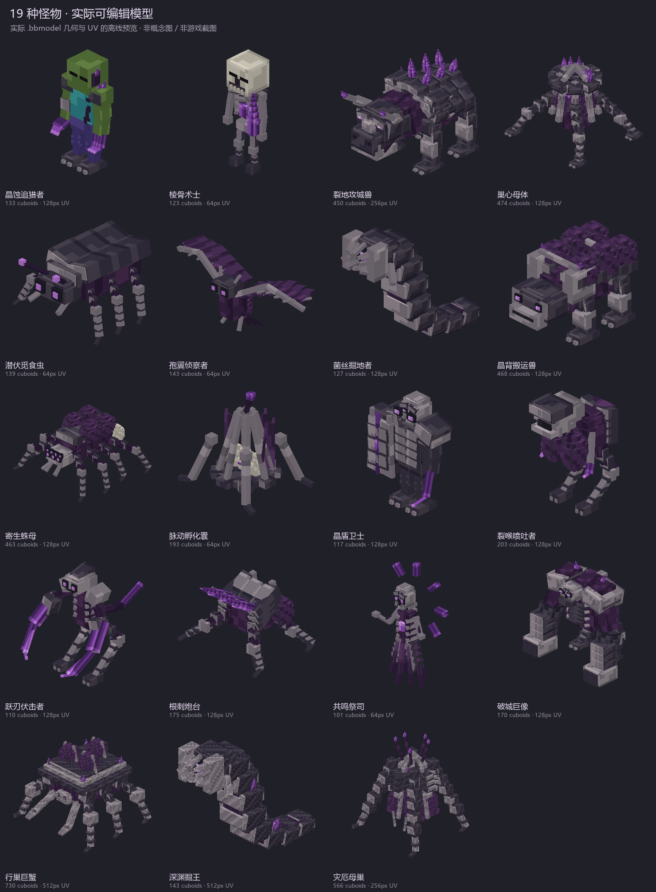
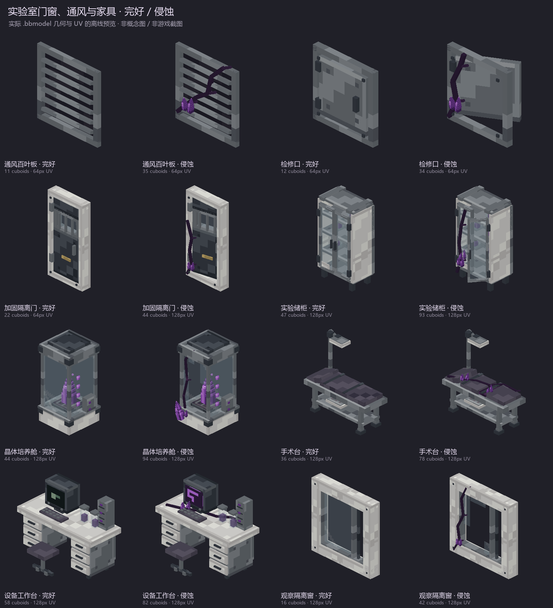

# 末影感染：可编辑 Blockbench 模型包（重做版 v2）

按本轮六张设计图重建的实际几何、UV 和分组。63 个 `.bbmodel` 全部内嵌 PNG，同时提供外置 PNG 方便继续绘制。16 模型单位为 Minecraft 的 1 格。

这次重做补充了怪物的分层甲壳、附肢护片、分瓣囊体、颅面和晶体结构，也补充了家具的五金、开合、培养舱破损玻璃与器械细节。它们是依据概念图制作的像素模型，不是从位图自动提取的完整三维扫描。

## 文件数量

| 类别 | 数量 | 文件夹 |
|---|---:|---|
| 怪物 | 19 | monsters/ |
| 护甲 | 2 | armor/ |
| 武器 | 4 | weapons/ |
| 掉落物 | 8 | loot/ |
| 实验室组件 | 28（14 类，各有完好/侵蚀版） | laboratory/ |
| 四层实验室整体 | 2（完整/剖视） | scenes/ |

## 先查看这些文件

- [攻城兽](monsters/ravager_siege_concept.bbmodel)
- [寄生蛛母](monsters/parasitic_spider_mother.bbmodel)
- [侵蚀培养舱](laboratory/crystal_incubator_eroded.bbmodel)
- [手术台](laboratory/surgery_table_intact.bbmodel)
- [四层实验室剖视](scenes/laboratory_complex_cutaway.bbmodel)
- [四层实验室完整建筑](scenes/laboratory_complex_complete.bbmodel)

## 打开与编辑

在 Blockbench 中用“文件 → 打开模型”打开 `.bbmodel`。项目采用通用模型格式，以保留自由几何、UV 和动画。贴图内嵌，因此移动文件夹后仍可读取。外置 PNG 与内嵌贴图内容已逐文件比对。

怪物的头、身体、四肢、下段关节和功能器官已分组；移动单位有走路或飞行动画，另有待机、攻击、出现和死亡关键帧。固定孵化体和炮台保留适合其结构的动作。储柜、隔离门和检修口有对应开合轨道，培养舱有脉动和气泡轨道。

护甲分成头盔、胸甲、双臂、双腿等组。`reference_player` 是可隐藏的参考人台；其元素 `export=false`，用于查看穿戴比例。

实验室是地表入口层和三层地下设施的整体建模布局，包含 24 个功能房间分区、楼梯开口、培养区、手术区、设备台、储藏柜和观察隔离窗。`level_1` 到 `level_4`、前/侧墙和屋顶可分别隐藏。完整与剖视文件是同一布局的不同可见状态。

## 实际模型预览

这里所有预览均由包内几何、UV 和关键帧渲染，不是概念图或 Minecraft 实机截图。

- [护甲、武器、掉落物](previews/equipment_actual.png)
- [实验室建筑方块](previews/lab_blocks_actual.png)
- [实验室完整建筑预览](previews/laboratory_complex_complete.png)
- [实验室剖视预览](previews/laboratory_complex_cutaway.png)
- [实际关键帧动作检查 GIF](previews/model_animation_check.gif)

## 验证与用途边界

文件验证已通过 63 个模型，检查 155328 个面的 UV 范围与绘制内容，以及 121 个动画轨道集的分组引用、循环端点和采样变换。双臂双腿、蜘蛛八足、攻城兽四足和巨蟹六足另作了结构检查。完整结果在 [validation.json](validation.json)。

这份交付是可编辑模型资产。新的怪物、物品、护甲、方块行为、配方、战利品和实验室世界生成尚未由这份资产包注册到 Mod；没有替换游戏 JAR。整体实验室 `.bbmodel` 也不是可直接放入世界的结构 NBT。

## 重建脚本

原创建模和检查脚本在 `source/`。安装其中 requirements.txt 列出的依赖后运行 `python source/build_pack.py`，会写入本包的 `rebuilt/` 文件夹，避免覆盖手工编辑的模型。随后可运行 `python source/validate_pack.py`、`python source/preview_pack.py` 和 `python source/animate_preview.py`。

## 模型索引

| 名称 | 几何元素 | 动画数 | 文件 |
|---|---:|---:|---|
| 晶蚀追猎者 | 133 | 5 | [crystal_hunter](monsters/crystal_hunter.bbmodel) |
| 棱骨术士 | 123 | 6 | [rib_crystal_caster](monsters/rib_crystal_caster.bbmodel) |
| 裂地攻城兽 | 450 | 5 | [ravager_siege_concept](monsters/ravager_siege_concept.bbmodel) |
| 巢心母体 | 474 | 4 | [brood_mother](monsters/brood_mother.bbmodel) |
| 潜伏觅食虫 | 139 | 5 | [lurking_forager](monsters/lurking_forager.bbmodel) |
| 孢翼侦察者 | 143 | 5 | [sporewing_scout](monsters/sporewing_scout.bbmodel) |
| 菌丝掘地者 | 127 | 5 | [mycelial_burrower](monsters/mycelial_burrower.bbmodel) |
| 晶背搬运兽 | 468 | 5 | [crystalback_carrier](monsters/crystalback_carrier.bbmodel) |
| 寄生蛛母 | 463 | 5 | [parasitic_spider_mother](monsters/parasitic_spider_mother.bbmodel) |
| 脉动孵化囊 | 193 | 4 | [pulsing_hatch_sac](monsters/pulsing_hatch_sac.bbmodel) |
| 晶盾卫士 | 117 | 5 | [crystal_shield_sentinel](monsters/crystal_shield_sentinel.bbmodel) |
| 裂喉喷吐者 | 203 | 5 | [rift_throat_spitter](monsters/rift_throat_spitter.bbmodel) |
| 跃刃伏击者 | 110 | 5 | [leapblade_ambusher](monsters/leapblade_ambusher.bbmodel) |
| 根刺炮台 | 175 | 4 | [rootspike_turret](monsters/rootspike_turret.bbmodel) |
| 共鸣祭司 | 101 | 6 | [resonance_priest](monsters/resonance_priest.bbmodel) |
| 破城巨像 | 170 | 5 | [siegebreaker_colossus](monsters/siegebreaker_colossus.bbmodel) |
| 行巢巨蟹 | 730 | 5 | [walking_brood_crab](monsters/walking_brood_crab.bbmodel) |
| 深渊掘王 | 143 | 5 | [abyssal_burrow_king](monsters/abyssal_burrow_king.bbmodel) |
| 灾厄母巢 | 566 | 4 | [calamity_brood_mother](monsters/calamity_brood_mother.bbmodel) |
| 晶壳轻甲 | 127 | 1 | [crystal_carapace_light_armor](armor/crystal_carapace_light_armor.bbmodel) |
| 母巢重甲 | 202 | 1 | [brood_heavy_armor](armor/brood_heavy_armor.bbmodel) |
| 棱晶长枪 | 49 | 1 | [prism_spear](weapons/prism_spear.bbmodel) |
| 裂地战锤 | 37 | 1 | [earthsplitter_hammer](weapons/earthsplitter_hammer.bbmodel) |
| 晶刺弩 | 35 | 2 | [crystal_spike_crossbow](weapons/crystal_spike_crossbow.bbmodel) |
| 共鸣法杖 | 42 | 2 | [resonance_staff](weapons/resonance_staff.bbmodel) |
| 感染组织 | 14 | 0 | [infected_tissue_pickup](loot/infected_tissue_pickup.bbmodel) |
| 菌丝束 | 21 | 0 | [mycelium_bundle](loot/mycelium_bundle.bbmodel) |
| 晶体碎片 | 24 | 0 | [amethyst_fragment_cluster](loot/amethyst_fragment_cluster.bbmodel) |
| 孢子囊 | 56 | 0 | [spore_pod_drop](loot/spore_pod_drop.bbmodel) |
| 甲壳板 | 12 | 0 | [chitin_plate_drop](loot/chitin_plate_drop.bbmodel) |
| 浓缩生物质 | 43 | 0 | [condensed_biomass_drop](loot/condensed_biomass_drop.bbmodel) |
| 共鸣器官 | 91 | 0 | [resonant_organ_drop](loot/resonant_organ_drop.bbmodel) |
| 母体核心 | 29 | 0 | [brood_core_drop](loot/brood_core_drop.bbmodel) |
| 白色实验室墙砖 · 完好 | 1 | 0 | [white_wall_tile_intact](laboratory/white_wall_tile_intact.bbmodel) |
| 白色实验室墙砖 · 侵蚀 | 25 | 0 | [white_wall_tile_eroded](laboratory/white_wall_tile_eroded.bbmodel) |
| 深灰墙砖 · 完好 | 1 | 0 | [dark_wall_tile_intact](laboratory/dark_wall_tile_intact.bbmodel) |
| 深灰墙砖 · 侵蚀 | 23 | 0 | [dark_wall_tile_eroded](laboratory/dark_wall_tile_eroded.bbmodel) |
| 实验室砖墙 · 完好 | 1 | 0 | [lab_brick_tile_intact](laboratory/lab_brick_tile_intact.bbmodel) |
| 实验室砖墙 · 侵蚀 | 23 | 0 | [lab_brick_tile_eroded](laboratory/lab_brick_tile_eroded.bbmodel) |
| 棋盘地砖 · 完好 | 1 | 0 | [checker_floor_intact](laboratory/checker_floor_intact.bbmodel) |
| 棋盘地砖 · 侵蚀 | 23 | 0 | [checker_floor_eroded](laboratory/checker_floor_eroded.bbmodel) |
| 实验室半砖 · 完好 | 1 | 0 | [lab_slab_intact](laboratory/lab_slab_intact.bbmodel) |
| 实验室半砖 · 侵蚀 | 23 | 0 | [lab_slab_eroded](laboratory/lab_slab_eroded.bbmodel) |
| 实验室楼梯 · 完好 | 2 | 0 | [lab_stair_intact](laboratory/lab_stair_intact.bbmodel) |
| 实验室楼梯 · 侵蚀 | 26 | 0 | [lab_stair_eroded](laboratory/lab_stair_eroded.bbmodel) |
| 通风百叶板 · 完好 | 11 | 0 | [vent_panel_intact](laboratory/vent_panel_intact.bbmodel) |
| 通风百叶板 · 侵蚀 | 35 | 0 | [vent_panel_eroded](laboratory/vent_panel_eroded.bbmodel) |
| 检修口 · 完好 | 12 | 2 | [service_hatch_intact](laboratory/service_hatch_intact.bbmodel) |
| 检修口 · 侵蚀 | 34 | 2 | [service_hatch_eroded](laboratory/service_hatch_eroded.bbmodel) |
| 加固隔离门 · 完好 | 22 | 2 | [reinforced_door_intact](laboratory/reinforced_door_intact.bbmodel) |
| 加固隔离门 · 侵蚀 | 44 | 2 | [reinforced_door_eroded](laboratory/reinforced_door_eroded.bbmodel) |
| 实验储柜 · 完好 | 47 | 2 | [lab_cabinet_intact](laboratory/lab_cabinet_intact.bbmodel) |
| 实验储柜 · 侵蚀 | 93 | 2 | [lab_cabinet_eroded](laboratory/lab_cabinet_eroded.bbmodel) |
| 晶体培养舱 · 完好 | 44 | 4 | [crystal_incubator_intact](laboratory/crystal_incubator_intact.bbmodel) |
| 晶体培养舱 · 侵蚀 | 94 | 4 | [crystal_incubator_eroded](laboratory/crystal_incubator_eroded.bbmodel) |
| 手术台 · 完好 | 36 | 0 | [surgery_table_intact](laboratory/surgery_table_intact.bbmodel) |
| 手术台 · 侵蚀 | 78 | 0 | [surgery_table_eroded](laboratory/surgery_table_eroded.bbmodel) |
| 设备工作台 · 完好 | 58 | 0 | [equipment_bench_intact](laboratory/equipment_bench_intact.bbmodel) |
| 设备工作台 · 侵蚀 | 82 | 0 | [equipment_bench_eroded](laboratory/equipment_bench_eroded.bbmodel) |
| 观察隔离窗 · 完好 | 16 | 0 | [observation_window_intact](laboratory/observation_window_intact.bbmodel) |
| 观察隔离窗 · 侵蚀 | 42 | 0 | [observation_window_eroded](laboratory/observation_window_eroded.bbmodel) |
| 末影实验室 · 四层剖视布局 | 9590 | 0 | [laboratory_complex_cutaway](scenes/laboratory_complex_cutaway.bbmodel) |
| 末影实验室 · 四层完整建筑 | 9590 | 0 | [laboratory_complex_complete](scenes/laboratory_complex_complete.bbmodel) |
