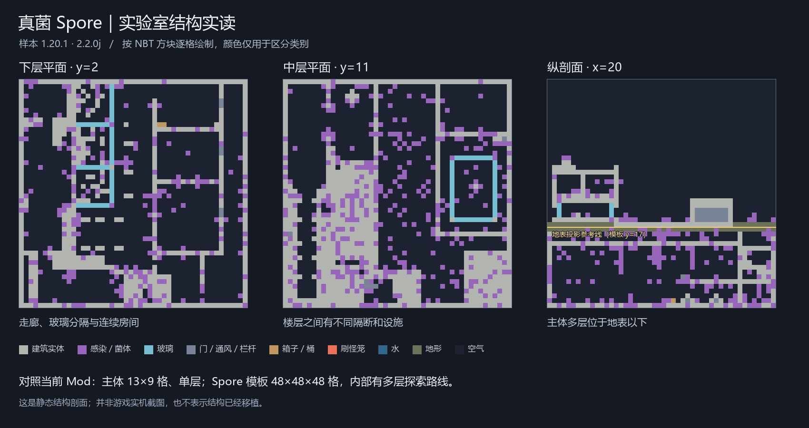

# 实验室生成、建筑方块与装饰物：当前 Mod 对比 Spore

核对日期：2026-11-02。此次是静态检查，没有修改生成器、替换游戏 JAR 或移植 Spore 资源。

样本为本地 `spore-1.20.1-2.2.0j.jar`；对照 `E:/mc/ender_infection_colored` 当前源码（build.gradle 标为 0.11.0-alpha.2）及 `E:/mc/dist/ender-infection-0.11.0-alpha.2.jar` 中的生成配置。不是对 Spore 所有版本的概括。

结论：当前差距同时存在于生成系统、内部空间、材料族、家具模型和实际摆放。只加高外墙或换成白色贴图，不能形成真菌实验室那样的探索体验。

## 1. 生成方式

| 项目 | Spore 样本 | 当前 Mod |
|---|---|---|
| 生成机制 | 原版 Jigsaw Structure + structure_set + NBT 模板 | 自定义 Feature + 网格 PlacementModifier，代码逐块搭建 |
| 研究站群系 | minecraft:mushroom_fields | 引用了未定义的 #minecraft:is_mushroom |
| 医院 / 监狱 | plains / jungle | plains / jungle |
| 研究站高度 | WORLD_SURFACE_WG 投影，start_height=-17，主体多层主要在地下 | WORLD_SURFACE_WG 表面起建，没有地下楼层 |
| 研究站密度 | spacing=32、separation=10 区块 | 参数同为 32 / 10，但不是原版 Structure 放置实现 |
| 医院密度 | spacing=48、separation=40，比研究站更稀少 | 仍用 32 / 10 |
| 世界种子 | 原版 random_spread 放置系统 | 网格随机数只由格网坐标和固定 salt 构成，未使用世界种子 |
| 定位 | 真正注册的 Structure 可被结构定位系统查找 | laboratories 标签列出的只是同名 Feature，没有对应 Structure 注册；不能因此获得 /locate structure 支持 |

32 区块约为 512 格的选点网格宽度，并非每隔 512 格一定出现一座建筑；候选点仍受群系等条件筛选。网格选点也不保证同一视野只能看到一座。

Spore 的 laboratories 标签列出研究站、医院、监狱、军事营地、矿道五种结构；医院起始池另有 hospital / asylum 两个等权模板。iceberg_mines 是另一个独立结构，没有列进这个五项标签。不能把所有外观差异都理解为同一研究站的群系换皮。

## 2. 建筑构成

| 项目 | Spore lab.nbt | 当前 InfectedRuinFeature |
|---|---|---|
| 模板 / 主体范围 | 模板边界 48×48×48，包含空气、地形及地上设施 | 外墙主体 13×9 格；地面外沿 15×11，清空范围 17×13 |
| 楼层 | y=0 / 5 / 9 / 13 有主要楼板，y=16–17 有地形覆盖层 | 单层，墙高 7 格；屋面 y=7，边沿 y=8，中央突出到 y=9 |
| 内部组织 | 不同楼层有不同走廊、隔墙、玻璃分隔、封闭区域和竖向设施 | 左右工作区与中央通道，三款共用外壳和隔断方式 |
| 地上轮廓 | 入口 / 玻璃和围栏设施 / 更高的设备轮廓 | 平屋顶边框与中央短突起 |
| 占据痕迹 | 完整建筑材料与侵蚀材料混用，墙面菌体、垂挂菌茎、根系、积水 | 中央节点、随机感染草与花、局部晶体装饰 |
| 可搜刮内容 | 19 箱子、14 桶；另有烟熏炉、酿造台、容器等 | 每款 2 箱子，共用 infected_lab 战利品表 |
| 敌人来源 | 模板含 6 刷怪笼：5 inf_hazmat、1 inf_player；结构还有 creature 类生成覆盖配置 | 模板生成器不放刷怪笼，主要依赖节点与阵营系统 |

NBT 中的方块数量不等于完整物件数量：lab.nbt 的 16 个 brown_bed 方块是 8 张完整床；16 个 reinforced_door 方块及 6 个 rusted_reinforced_door 方块分别是 8 扇及 3 扇双格门。旧研究文件将方块数量直接写为床 / 门数，应以本次核对为准。

图按 NBT 数据逐格绘制，颜色表示方块类别，不是原始贴图或游戏截图。未实际步行验证所有通路可达性。

## 3. 对应的实验室方块

| 材料类别 | Spore 的实际资源 | 当前 Mod 的情况 / 差距 |
|---|---|---|
| 基础墙面 | lab_block 系列 4 种，16×16 贴图 | lab_tile / light / dark 已有，但类型与用途区分较少 |
| 地面 | 独立的黑白棋盘类材料，普通地砖与其他建筑材料配合 | lab_checker 已注册，研究站 floorState 实际选用亮砖和磨制安山岩，没有使用它 |
| 建筑形体 | 对应实验室半砖与楼梯 | 当前实验室材料没有对应注册的专用半砖 / 楼梯族 |
| 侵蚀版本 | infested_laboratory_block 系列，与未侵蚀版本对应 | 缺少明确成套的“完好实验室材料→侵蚀版”对应关系；晶体结壳不能替代全部建筑材料 |
| 通风系统 | vent_plate / rusted_vent_plate / vent_door，方向与开闭状态 | 缺少对应的实验室通风板、检修门及管道系统 |
| 门窗与隔离 | 加固门、锈蚀门、玻璃板、铁栏 | 当前生成器主要是门洞与玻璃 / 铁栏，缺少可操作的专用隔离门 |

lab.nbt 实际包含 220 个 vent_plate、12 个 vent_door 方块、737 个玻璃板方块和 324 个铁栏方块。通风门半部数量不配对，不能直接将 12 除以 2 声称有 6 扇完整门。

## 4. 对应的家具和装饰物

必须区分 Mod 提供的物件与特定模板实际摆放的物件。Spore 提供 cabinet / incubator / surgery_table / laboratory_bed 等资源，但本次 lab.nbt 并没有摆 cabinet、incubator 或 surgery_table，不能把整个物件库都当成这座实验室已有的摆设。

| 物件 | Spore 的资源实现 | 我们当前的实现 | 当前建筑是否摆放 |
|---|---|---|---|
| 储柜 | cabinet_closed / cabinet_open 独立模型，带朝向及开闭状态；关闭模型含 48 个元素 | lab_cabinet 使用 cube_all，同一纹理铺六面，没有柜门 / 柜脚几何 | 否 |
| 培养器 | incubator 独立 5 元素模型、128×128 UV 图集 | incubator 使用 cube_all；有随机 tick 孵化逻辑 | 否；研究站另用普通玻璃和感染方块拼罐子 |
| 手术台 | surgery_table 独立 55 元素模型、128×128 UV 图集 | surgery_table 使用 cube_all；有附近感染体治疗逻辑 | 否 |
| 病床 | laboratory_bed 有定向、分段模型；lab.nbt 本身使用原版棕床 | 医院摆放原版白床，但当前代码连续放两个默认 foot 状态，没有正确设置 head / foot | 医院有床方块，完整床状态需要修正 |
| 小型陈设 | lab.nbt 中有箱、桶、酿造台、容器、告示牌、拉杆及灯具 | 原版酿造台、炼药锅、书架和灯笼 | 部分有，缺少按房间用途的成组布置 |

模型元素数量只用于确认它们确实是独立几何模型，不是质量标准。自制家具应优先让柜门、桌腿、玻璃舱、底座、仪表和接口的轮廓可读，不必追求相同元素数量。家具图集大于 16×16 也可以保留原版 16× 的像素密度；重点是每个模型面的 UV 比例。

## 5. 当前已确认的问题

1. **蘑菇群系引用缺失。** 原版客户端包、当前资源目录和 0.11.0-alpha.2 分发 JAR 均没有定义 minecraft:is_mushroom 标签。默认组合不能依靠它选中蘑菇岛；应显式指定 mushroom_fields 或定义自己的群系标签。
2. **候选坐标未混入世界种子。** GridPlacement 只使用 cellX / cellZ / salt 创建随机数；编解码 getter 还返回已乘 16 的内部距离，需要在修改时同时审查单位往返。
3. **野生节点初始化检查错位。** 节点放在 base+(0,0,0)，markWild 却检查 base+(0,-1,0) 的地板实体，正常情况下不会命中该节点。这会阻止它走 wild 分支自行萌生母体；若附近有现存母体，仍可能被认领。
4. **家具与地砖没有接入生成。** 注册完成不等于建筑已经使用；上表四项目前都没有接入对应摆放。
5. **医院床状态不成对。** 直接放置默认 WHITE_BED 两次，不能构成正常的头尾组合。
6. **结构测试仍扫描旧高度。** laboratoryHasRoomsWindowsBenchesAndLoot 只扫描 y=0..4 的灯笼，却把灯笼放在墙高 7 对应的 y=6；屋顶断言仍检查 y=5，而屋顶已在 y=7。未运行本轮测试，不能宣称这些测试已验证当前建筑。
7. **地形适配不足。** 只对起点向下查找空气、统一清空包围盒，没有对整个建筑地基进行坡度、树冠、水体、邻近结构的选址评估。具体悬空 / 覆盖表现仍需多种地形实测。

附带观察：IncubatorBlock 仅调用 canExpand 检查余额，未执行对应扣费；若后续把它接入建筑，应先补齐成功生成时的事务扣费和单位上限，否则会产生不消耗生物质的额外产兵。

## 6. 建议落实的顺序（尚未实施）

1. 先修生成与节点问题，再把定位、种子、密度、地形适配做成可验证的 Structure 实现。
2. 做统一建筑材料族：白 / 灰墙砖、棋盘地砖、半砖楼梯、加固门、窗框、通风板与检修口；保留可识别的完好与侵蚀两版。
3. 把柜子、培养舱和手术台做成真正的家具轮廓，并给朝向、碰撞、开闭及功能合理的状态。
4. 按用途组合房间：入口安检、储藏、观察、培养、手术、收容、设备 / 通风区；让家具、战利品和敌人来源与房间对应。
5. 再扩成多层地下研究站，连接地上入口；医院 / 监狱另用符合功能的布局，避免仅给同一个盒子换材料。
6. 特效集中在工作设备和感染源：培养液气泡、警示灯、通风口少量孢子、晶体脉冲。完整区域保留中性的工业配色，侵蚀区逐步加入黑紫菌体和晶体。

这些是自制内容的设计方向，不代表已复制或移植 Spore 模型、贴图、模板。

## 7. 证据与边界

- REA 归档检查：ev_44475616aeb22052a83cf74572ecde83e68dfc2a04f1ad2cfa1d52b0b67db113。
- Spore JAR SHA256：d20c4be6606f9752ecfd964eba625363eb76a28e327d67fe6dda4be748401489。
- 原始结构统计：[comparison_evidence_2026-11-02.json](comparison_evidence_2026-11-02.json)，包含逐层统计、刷怪笼数据、容器 NBT、结构与放置配置。
- 我方主要源码：[InfectedRuinFeature.java](E:/mc/ender_infection_colored/src/main/java/dev/hui/enderinfection/worldgen/InfectedRuinFeature.java)、[GridPlacement.java](E:/mc/ender_infection_colored/src/main/java/dev/hui/enderinfection/worldgen/GridPlacement.java)、[InfectedContent.java](E:/mc/ender_infection_colored/src/main/java/dev/hui/enderinfection/InfectedContent.java)。
- 本轮没有启动客户端或执行世界生成；静态配置、模型和数据观察不等于游戏内运行验证。
