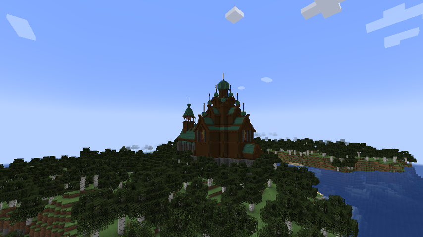
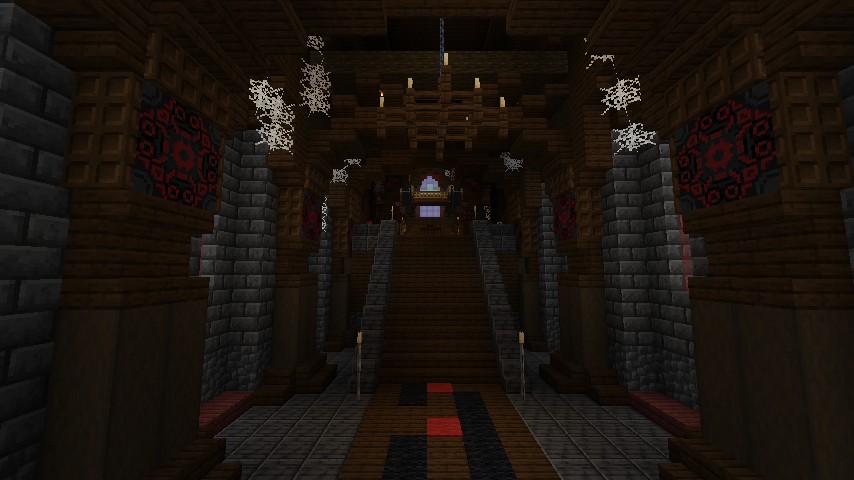

# 生存玩法与物品手册

适用于主模组 0.12.0-alpha.6。研究所任务按[主线流程](main-progression.md)进行；安装见[首页](../README.md)。

## 晶体装备与开局陨石

共鸣晶、余烬晶和虚空晶各有四件护甲、镐、斧、铲、锄和剑，共 27 件。用对应晶体按原版装备形状合成，工具和剑另用木棍。铁砧可用对应晶体修理。创造栏和物品提示中能看到三套装备及其能力。三套护甲都有随手臂摆动的立体肩甲、盔沿和护靴。共鸣甲的背晶向两侧分叉，余烬甲用双晶排气座，虚空甲有外伸肩刃和中央青色长晶。

| 系列 | 四件套护甲 | 工具 | 剑 |
|---|---|---|---|
| 共鸣晶 | 来自本 Mod 感染单位的伤害降低 20% | 使用适配工具采掘矿石，或站在感染地面上采掘时，速度提高 35% | 对感染单位额外造成 25% 伤害并标记 3 秒 |
| 余烬晶 | 火焰类伤害降低 40% | 在下界使用适配工具时，速度提高 25% | 命中点燃目标 3 秒 |
| 虚空晶 | 摔落伤害减半，弹射物伤害降低 20% | 空中使用适配工具时，采掘速度乘以 3 | 右键抛出末影珍珠，消耗 2 点耐久，冷却 12 秒，按珍珠规则传送 |

共鸣晶与余烬晶工具采用铁镐级采集等级，虚空晶工具采用钻石镐级采集等级。三套的材料来自相应矿石，共鸣系列使用共鸣碎片。

新世界首位玩家进入主世界约 5 秒后，聊天栏提示落点，紫色陨石从附近天空下坠。约 2.2 秒后，陨石以威力 5.5 的爆炸撞击地面，伤害并击退附近生物。在允许地形破坏时，冲击会在自然地面炸出陨石坑，随后优先在坑内生成第一阶段母体。地形破坏遵守 `mobGriefing`。事件保存在世界数据中，飞行和撞击状态会随读档继续。和平难度期间暂停。

可移动的侵蚀和畸变单位会在安全落点之间闪现，追击可见目标或躲避弹射物。冷却中也会免疫箭矢、三叉戟等弹射物伤害。母体、孵化囊和根刺炮台保持扎根，享有同样的弹射物免疫。母体目击被闪避的弹射攻击时仍会学习远程战术。

进度界面新增「末影感染」页，共九项，涵盖见证陨石坠落、取得三种晶体、集齐三套护甲及击杀母体。

## 晶矿

| 矿石 | 矿脉起始高度 | 最低镐等级 | 用途 |
|---|---|---|---|
| 共鸣晶矿、深层共鸣晶矿 | 主世界 Y -56 到 48，矿脉在 Y -4 附近更常见 | 铁镐 | 掉落共鸣碎片，用作晶刺弩弹药和抑制粉原料 |
| 余烬晶矿 | 下界地狱岩中，Y 20 到 100 | 铁镐 | 用余烬晶体替代灯板配方的萤石粉，每次做出两块实验室灯板 |
| 虚空晶矿 | 末地外岛高地和中地，Y 32 到 72 | 钻石镐 | 一颗虚空晶体和一个雪球做出六份抑制粉 |

矿脉随新区块自然生成。矿石支持时运和精准采集，普通开采会掉落经验。四种矿石方块和两种晶体可在「末影感染」创造栏找到。

## 节点扩张

节点按生物质储备计时扩张，修复之前每个 tick 都扫描和扣费的问题。连续坡面与裸露崖面都能向上感染；搜索高度随节点范围增长，高台也能成为子节点的落脚点。新前哨按**尚未被节点覆盖的可感染地形和剩余肥力**评分，扣除母节点本身的覆盖，优先向新领土推进。年轻节点可沿相连的旧感染带向外增长，避免被母节点的覆盖困住。

地表优先于树冠维护；前方无可感染地形时不购买空半径。前哨被毁后可付费补建，未加载的子节点保留记录。母体随节点数量保留 16～64 生物质作为扩张周转金；升级也要留下这笔钱。高处感染领土计入收益，土地衰竭与各母体独立储备规则继续保留。

机制、费用、限制和测试方法见 [扩张说明](expansion.md)。使用 `/enderstrategy` 查看附近节点的搜索高度、扩张轮次与下一轮等待时间。

## 导入建筑与世界生成

修复靠近自然实验室时远处地形空白的问题：大型设备的占位方块在灯光线程读取邻区块，导致区块生成与灯光互相等待。现在光照路径使用固定透明形状，碰撞仍跟随已加载的设备根方块。修复前已在独立噪声世界复现，修复后重新检查原生自然生成。

打开门后仍无法通过的问题也已修复：上下门框从 1.7 像素缩到 1 像素，模型与碰撞同步，净高 **1.875 格**。站立玩家实际移动验证覆盖完整/侵蚀门的四种朝向和六类旧入口。

按用户选择，建筑改用真实的上游结构文件。保留原体量与构造，转换方块和容器；不把导入建筑声明为原创。源文件、映射脚本、作者和许可均保留在 [third_party/architecture](../third_party/architecture/README.md)。

| 建筑 | 来源 | 大小（宽×高×长） | 指令 |
|---|---|---|---|
| 废弃工业实验室 | HBM | 19×17×21 | `/enderbuild hbm_laboratory` |
| 废弃工厂 | HBM | 38×41×19 | `/enderbuild hbm_factory` |
| 极地科考站 | HBM | 38×14×24 | `/enderbuild hbm_arctic` |
| 废弃教堂 | Church of Sin | 37×58×70 | `/enderbuild church` |





四套建筑跳过水域和大于 5 格高差的陡坡，分别在对应群系尝试自然生成，完整群系和转换说明见 [导入建筑说明](imported-buildings.md)。旧方盒布局已停止自然生成，原有六套 `/enderlab` 调试布局与旧存档中的建筑保留。

手动放置在玩家东侧 64 格开始，会替换建筑空间中的原有方块。每两个 tick 处理一个区块，进度保存到存档；`/enderbuild status` 查看进度，`/enderbuild cancel` 停止后续放置。请在测试世界或空旷区域使用。

**Lua Lab** 已准备本地 `.litematic` 转换与加载入口，当前尚未取得作者下载文件，因此没有打包或声称安装了这套园区。导入方法见 [说明](imported-buildings.md#lua-lab)。其转换件不随公开 JAR 分发。

旧调试布局增加了双向升降平台和金属检修梯，保留 30 种房间源布局、56 个功能区和 9 处破损区域。平台通过玩家传送连接楼层；右键上行、潜行右键下行，顶层右键下行，目标落点堵塞时拒绝传送。已有旧建筑不会自动重建。

## 历史兼容修复

修复实验室通风口、储柜、门、检修口、观察窗、工作台和手术台的空发光蒙版崩溃。无有效发光像素时跳过发光层；有效晶体发光效果保留。新增资源重载缓存清理，导出器与校验器拒绝空发光蒙版。

客户端验证现在实际执行 GeckoLib 发光纹理注册：33 张有效蒙版注册通过，7 种无发光设备被跳过。此前仅烘焙模型和贴图的检查未覆盖这条崩溃路径。

## 怪物与建筑概览

- 19 款怪物设计进入游戏：14 种新专职单位，以及重做的追猎者、棱骨术士、攻城兽、母体与灾变母体。灾变母体对应第五阶段，沿用母体阵营和储备。第一至第四阶段目前共用同一设计并逐级放大，外观区分主要来自体型。
- 新单位使用骨骼模型、逐面 UV、待机、移动、攻击、登场和死亡动画，攻击关键帧与服务端命中时机对应。
- 侦察者标记目标，搬运兽回收材料，晶盾卫士正面减伤，喷吐者发射带毒晶体，祭司治疗与减伤支援，孵化单位按母体储备付费并遵守人口上限。
- 2 套四件式护甲、4 种武器和 8 类掉落材料；包含合成、修理、耐久、冷却和晶刺弩弹药消耗。
- 14 类实验室构件的完整/侵蚀版本，加上 12 件功能与装饰摆件，共 40 个方块。门和储柜可开合，培养舱有动态标本，手术台提供治疗，升降平台连接楼层。
- 四套署名导入建筑进入自然生成；旧六套实验室调试布局保留大厅、中庭、连桥、竖井、破损区域、升降平台和分类补给箱。

## 单位

| 单位 | 主要作用 | 最低母体阶段 |
|---|---|---|
| 潜伏觅食虫 | 优先标记附近猎物，受重伤时拉开距离 | 1 |
| 孢翼侦察者 | 在猎物上方绕飞，标记后从空中发射晶刺 | 2 |
| 晶背搬运兽 | 主动回收残骸，绕路将生物质交给所属母体 | 2 |
| 脉动孵化囊 | 固定孵化阵地，付费生产觅食虫 | 2 |
| 菌丝掘地者 | 沿地面突进，在目标附近唤出晶刺 | 3 |
| 寄生蛛母 | 守在孵化地附近，消耗母体生物质孵化幼蛛 | 3 |
| 晶盾卫士 | 默认驻守，面向攻击者减伤并挡在前线 | 3 |
| 裂喉喷吐者 | 主动拉开射距，避开友军后喷吐毒晶 | 3 |
| 跃刃伏击者 | 蓄力后跨过间隔，贴身挥出双镰 | 3 |
| 根刺炮台 | 固定远程晶刺阵地 | 3 |
| 共鸣祭司 | 跟随交战友军，在后排治疗和施法 | 4 |
| 破城巨像 | 沿蓄力方向冲撞，接范围重击和晶刺 | 4 |
| 行巢巨蟹 | 在近处交战，消耗生物质孵化护卫 | 5 |
| 深渊掘王 | 维持距离，以远程晶刺法阵封锁地面 | 5 |

14 种单位按设计图重建主体轮廓：低伏虫体、横向宽翼、鼓胀货囊、外张八足与吊卵、低垂三卵孵化腔、分离双喉囊、弧形长镰和拱尾、三联晶矛、根须裙摆与分层巨拳。行巢巨蟹改为隆起叠甲和粗壮外张步足，深渊掘王改为连续弯曲的长躯与开放环形口器。骨甲、软组织和紫晶分层着色，Blockbench 模型、UV、动画与游戏资源同步导出。[生态单位、战斗单位与巨兽的原始设计图](../previews/ender_faction_concepts_2026-11-02/)。

新增单位、重做怪物、旧感染生物与母体各阶段，紫晶的暗面和尖端均纳入自发光蒙版，暗处保留晶体颜色与棱面层次，飞行晶刺也保持自发光。可用 `gradlew.bat runClient -PcrystalGlowCheck` 在独立暗室生成 34 个实体的正反面截图，检查天空光和方块光均为 0 时的效果。

单位分别选择接敌和支援方式，并响应所属母体的回防命令。低于 64 生物质时，母体优先使用原有低成本兵种；大型单位还需要足够的出生空间。

## 装备

| 物品 | 操作 |
|---|---|
| 棱晶长枪 | 左键近战；右键前方窄角度突刺 |
| 裂地战锤 | 左键近战；右键范围震击 |
| 晶刺弩 | 按住右键至少 15 tick 后松开；消耗 1 个晶体碎片，发射 3 枚晶体 |
| 共鸣法杖 | 右键发射魔法晶体并显示法阵 |
| 晶壳轻甲 | 四件套持续清除本 Mod 的末影侵蚀效果 |
| 母巢重甲 | 四件套濒危时提供临时吸收与本次减伤，20 秒冷却 |

## 建筑调试指令

需要开启作弊或拥有管理员权限。手动放置会替换对应区域的方块。

```mcfunction
/enderbuild list
/enderbuild hbm_laboratory
/enderbuild hbm_factory
/enderbuild hbm_arctic
/enderbuild church
/enderbuild status
/locate structure ender_infection:imported/church
```

新建筑使用原生结构集，40 / 14 区块间距；群系条件仍需满足。已生成的旧区块不会新增建筑。

旧实验室调试命令仍可用：`/enderlab research|swamp|forest|medical|snow|badlands|auto`。其聊天栏给出入口坐标。`hospital` 和 `prison` 分别兼容映射到旧医疗站和采掘设施。
