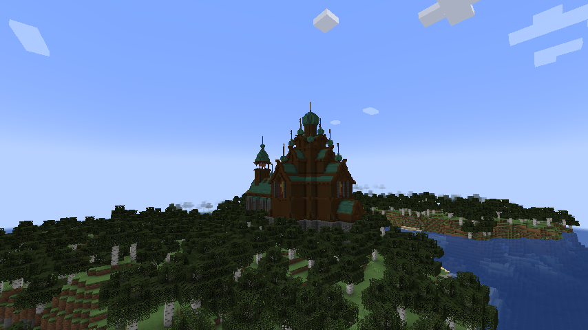
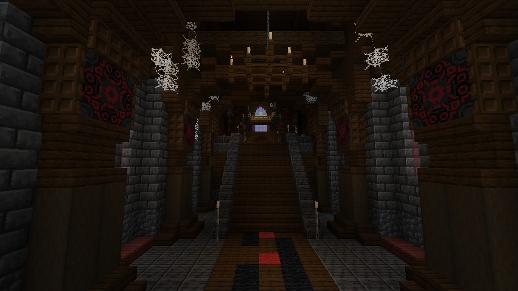
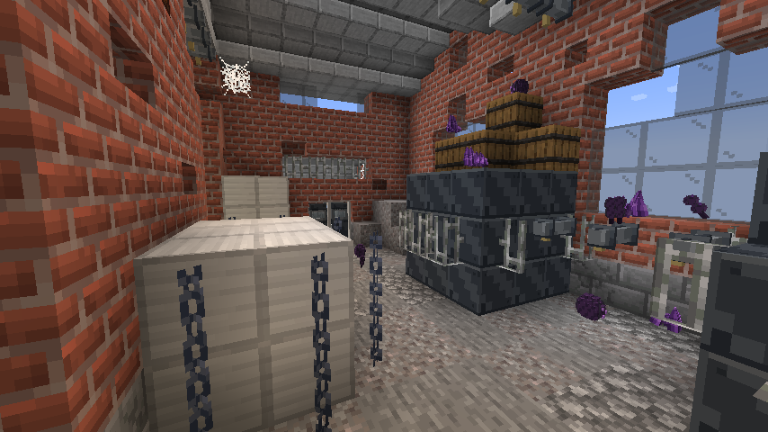
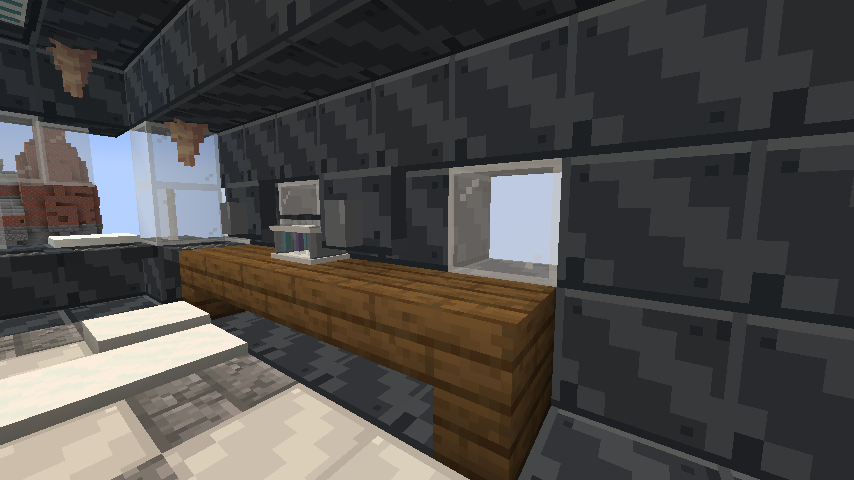

# 现成建筑与本地导入

本轮改用实际上游建筑，保留其建筑轮廓。工业设施来自 HBM，教堂来自 Church of Sin；[作者、原文件、转换差异和许可](../third_party/architecture/README.md)均保留。

| 指令 | 建筑 | 大小（宽×高×长） | 自然生成群系 |
|---|---|---|---|
| `/enderbuild hbm_laboratory` | 工业实验室 | 19×17×21 | 平原、繁花森林、蘑菇岛、沼泽、黑森林 |
| `/enderbuild hbm_factory` | 废弃工厂 | 38×41×19 | 恶地、繁茂恶地、裸岩山峰 |
| `/enderbuild hbm_arctic` | 极地科考站 | 38×14×24 | 雪原、雪地针叶林、冰刺平原 |
| `/enderbuild church` | 废弃教堂 | 37×58×70 | 白桦林、原始白桦林、草甸 |

自然生成使用基于原生 jigsaw 的选址结构，按建筑真实旋转后的占地九点采样，比较地表与水底高度以拒绝水域，并拒绝高差超过 5 格的地点；干燥的超平坦世界也可使用；不在生成线程请求邻区块。，间隔 40 区块、最小分隔 14 区块，群系条件仍需匹配。不同建筑没有同一候选点，不保证每个群系都有建筑。旧方盒实验室停止自然生成，原 `/enderlab` 指令和已经生成的旧建筑保留。

手动指令需管理员权限，会替换玩家东侧 64 格起点的对应建筑空间，请在测试世界或空旷区域使用。每两个 tick 放置一个区块，`/enderbuild status` 看进度，`/enderbuild cancel` 停止后续放置；已经放置的部分保留。任务存入当前维度的 SavedData，退出后可继续。自然生成由引擎分区块处理，不使用手动放置队列。

## Lua Lab

[Lua Lab 原作者下载页](https://www.planetminecraft.com/project/lua-lab/)提供地图与 `.litematic`。作者页面未注明再分发许可，因此转换件只在本地使用，不进 GitHub 或公开 JAR。

拿到 `.litematic` 后，从项目根目录运行：

```powershell
python tools/import_architecture.py --lua "E:\mc\imports\Lua Lab.litematic"
```

将 `imports/generated/lua_lab.nbt` 和 `lua_lab.json` 放进该游戏实例的 `config/ender_infection/imports/`。随后 `/enderbuild list` 会列出本地 Lua Lab，使用 `/enderbuild lua_lab` 放置。该本地导入项只支持手动放置；没有本地文件时不会列出，也不会假装安装成功。工具读取原建筑方块，不重建一个外形类似的方盒。

转换器保留原版方块；非原版依赖需对应模组。运行时限制宽、长各不超过 512 格、高不超过 192 格、体积不超过 1600 万格。大型地图建议先在独立测试世界预览。

## 自然生成卡住的修复

曾在噪声世界重现：设备占位方块的动态形状在灯光工作线程读取邻区块的根方块，引发邻区块 FULL 状态与灯光任务循环等待。占位方块现在对光照固定透明，光照路径不再读取邻区块；碰撞仍跟随已加载根方块的开关状态。测试保留了修复前线程栈、修复后真实自然结构生成，以及严格禁止邻方块读取的光照回归。

## 实际游戏截图

白桦林中自然生成的教堂；已检查 11,428 个主要建筑方块完整。



教堂主厅，未使用光影包。



以下两张在独立开发世界使用夜视检查设备与室内构造，展示原版渲染，不代表自然灯光亮度。





## 验证状态

最终建筑专项 8/8：注册方块与状态、四套有效原生结构片段、分区块放置和存档恢复、门口碰撞与升降平台。教堂与 HBM 实验室均实际执行了噪声世界自然生成和周围区块 FULL 加载检查；教堂还核对了主要建筑方块数量，未只检查结构起点。

完整回归 79/81；攻城兽晶体波与骷髅射击通路检查在这一轮失败，使用相同断言单独复查 2/2 通过。这两项仍作为间歇性测试问题保留，没有降低断言或将完整回归写成全通过。Lua 解码器通过负尺寸、三维坐标和跨 64 位边界的独立样本检查；Lua Lab 实际地图未取得，因此没有实地图导入验证。
