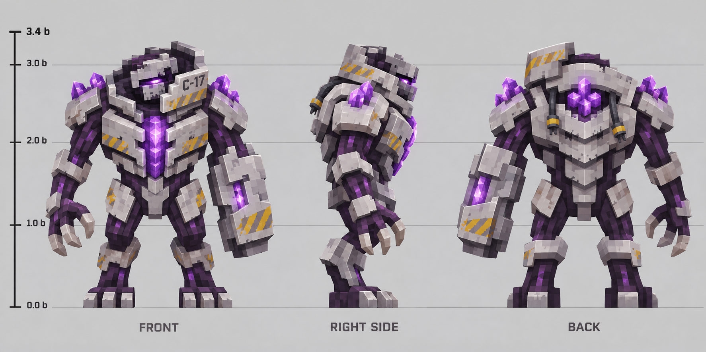

# 研究所 Boss：收容监管体

开发阶段：**三视图、MCP 模型与七段动画首版完成；战斗和奖励尚未接入游戏。** 已发布版本仍为 [0.12.0-alpha.6](https://github.com/fl749731-lab/ender-infection/releases/tag/v0.12.0-alpha.6)，玩家主线到 [E8 收容事故](containment-incident.md)。

## 外观与资源

原创研究所感染守卫，约 3.4 格高。浅灰收容装甲包裹深紫感染组织，左臂为固定护臂，右手三爪；胸口装甲可张开，露出紫晶核心。高领固定框、C-17 编号、肩部晶簇和背部三层甲片用于识别轮廓。

三视图是比例和材料参考；实际模型采用 Minecraft 方块骨骼表达，见[实模效果和检查记录](../previews/institute-boss-alpha7/README.md)。模型与图纸存在的差异、贴图和导出限制在该页统一说明。

## 当前进度

| 项目 | 状态 |
|---|---|
| 正面、右侧、背面设计图 | 已保存 |
| Blockbench MCP 可编辑实体模型 | 128 个方块、21 根骨骼 |
| 基础贴图与紫晶发光遮罩 | 两张 256×256 PNG；所有紫晶面含暗面均覆盖 |
| 待机、行走、爪击、跺地、晶体爆发、核心暴露、倒地 | 已制作并采样检查 |
| 几何和动画导出 | 已保存；等待 Java 客户端接入验收 |
| 实体、AI、Boss 血条和攻击判定 | 待实现 |
| 设施触发、进度存档和一次性奖励 | 待实现 |
| Forge / NeoForge 原生测试与客户端验收 | 接入后执行 |

## 接入方案

以下为待实现设计，不属于 alpha.6 的玩法说明。

入口安排在完成 E8 与核心档案之后。优先评估 B3 / F8 裂隙大厅，先核对净空、门宽和玩家回避路线，再确定出生点与终端坐标。建筑调整继续使用方块坐标和原生结构。

战斗由三种可预判攻击组成：右爪近距离横扫、抬腿蓄力后的地面冲击、胸口开甲后的三次晶体脉冲。以动画的蓄力、出手和收招时点驱动判定；攻击需要距离、视线和冷却约束。护臂与两侧设施的互动用于制造核心暴露窗口，避免只靠增加血量延长战斗。

拟定动画事件：爪击 0.85 秒出手；跺地 1.1 秒落地；爆发在 1.0、1.3、1.6 秒脉冲。这些目前仅是动画时点，尚无伤害、声音或粒子事件。

每所设施保存 Boss 身份、战斗阶段与领奖状态，覆盖重启、卸载、多人同时触发和背包已满的情况。击败奖励拟为收容核心及后续抑制设备材料；具体配方和数值随战斗验收确定。共振工业保持可选附属，不作为通关必装条件。

接入顺序：双版实体与渲染 → 技能和碰撞 → 场地与设施状态 → 奖励 → 双版原生测试 → 客户端外观和战斗验收。新版本通过完整发布门槛后再打包。
