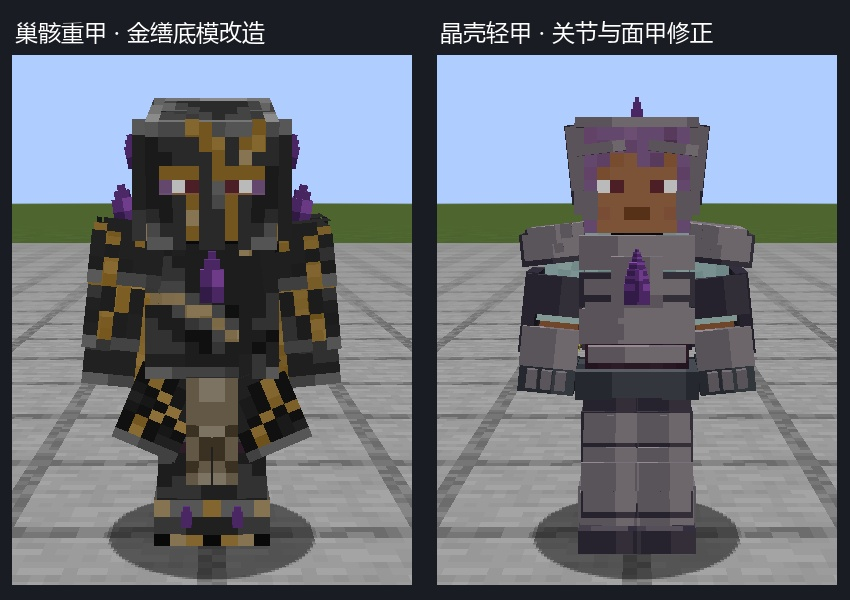

# 护甲改造实机验收

巢骸重甲采用 @eanncrod 的 Kintsugi Armor（CC BY 4.0）并适配紫晶、分裙和原版穿戴骨骼；晶壳轻甲保留项目自有分片结构，清理肩带、面甲和重复晶核。来源、许可边界、MCP 编辑源及改动细节见[模型包](../../colored_units/armor_rework_v1/README.md)。

- [Forge 全部姿势与单件穿戴](forge-review.jpg)
- [NeoForge 全部姿势与单件穿戴](neo-review.jpg)
- [重甲 Blockbench 网页预览启动页](brood-heavy-viewer.html)：下载后用 Chromium 浏览器打开；模型通过 URL 片段载入，不上传源文件。

两版分别在各工程 `build/armor-visual-check` 下创建独立世界。每套护甲检查正面、背面、真实按键走动、蹲下、拉弓、骑乘、头盔／胸甲／护腿／靴子单独装备、两套混穿、物品栏和零光照暗室，共 **26 场景 × 2 版 = 52 张原生截图**。

运行时在原生 `GeoArmorRenderer` 完成姿势复制后检查八个骨骼与对应 `HumanoidModel` 的旋转，截图场景最大旋转差为 0；同时验证每个装备槽只显示规定骨骼、混穿后渲染器没有串用另一套资源。走动、蹲下、拉弓和骑乘另断言角色的真实状态及骨骼变化。图像目检补查裙甲跟腿、面罩遮挡、肩甲和手持武器关系。这里只覆盖所列姿势，不等于穷尽所有模组自定义动作。

暗室方块光与天空光均为 0。两套紫晶仍可见，装甲和金色纹路不自发光；检查区域只包含世界中的角色，排除背包或快捷栏。背包画面展示八件重新烘焙的物品模型，固定鼠标绘制位置以避免工具提示遮挡格子，未修改物品渲染逻辑。

`runtime/forge` 与 `runtime/neo` 保存最终客户端日志及原始 1280×800 截图；对照页只是这些截图的裁剪排版。`verification.json` 锁定当前源文件、实际截图、日志和两版构建摘要。`python tools/verify_armor_runtime.py` 可验证该开发检查点。

资源检查覆盖 49 份几何、61,692 个面和 69 个源模型映射。原有 18 项导出回归通过；两版主模组、API 开发包及附属示例均构建通过。护甲属性、配方和套装效果没有改动。本批验证使用真实客户端场景，**没有重新运行完整发布 GameTest 门槛**，也不能把 52 张截图称作 52 项服务端 GameTest。

这是 alpha.8 开发分支的验收记录，未新建公开发行。公开下载仍是 alpha.7。继续处理初期人形感染者、其余武器、三套基础晶甲、普通特效、母体及设备／建筑部件。
