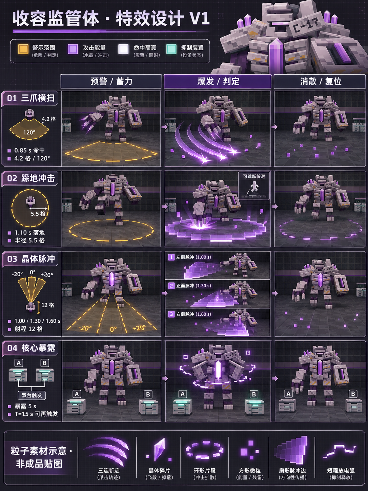

# 收容监管体 · 特效设计 V1

这是收容监管体增强特效 V1 的目标图，沿用现有 MCP 模型和七组动作。本轮 alpha.7 开发源码已加入预警、斩痕、分段冲击环、扇形脉冲、抑制台放电与核心符文；公开 alpha.6 不含这些内容。[本轮运行记录](runtime/README.md)单独保存实际画面与验证范围。

## 分镜与时点

每行一种效果，三列依次为预警／蓄力、爆发／判定、消散／复位。时间按当前服务端技能配置，20 tick 为 1 秒，不改变伤害和冷却。

| 效果 | 预警与蓄力 | 爆发时点与范围 | 消散与复位 |
|---|---|---|---|
| 三爪横扫 | 指尖短光线，橙金虚线扇区，保留地面视野 | 第 17 tick／0.85 秒，半径 4.2 格、前方 120°；三道短紫晶斩痕沿右爪移动 | 斩痕碎成少量晶屑，动作总长 1.8 秒 |
| 跺地冲击 | 抬右腿，橙金分段圆环标出范围 | 第 22 tick／1.10 秒，半径 5.5 格；脚底冷白闪光与低矮扩散环 | 圆环拆成像素段淡出，动作总长 2.4 秒 |
| 晶体脉冲 | 核心蓄光，三个橙金扇区标明顺序和方向 | 第 20／26／32 tick，即 1.00／1.30／1.60 秒；依次为 −20°／0°／+20°，各宽 20°、射程 12 格 | 扇面边沿散成微粒，动作总长 2.6 秒 |
| 核心暴露 | A、B 两座抑制台分别显示放电状态 | 两台触发后，胸甲张开，核心冷白紫光增强，局部破碎符文环绕；持续 100 tick／5 秒 | 核心与胸甲复位；从双台触发起计时 300 tick／15 秒后可再次触发，包含前面的 5 秒暴露 |

方向以监管体蓄力开始时的朝向为准。扇形脉冲按左、中、右顺序释放；三道同时出现的完整扇面仅用于范围示意。跺地的扩散环属于视觉反馈，伤害仍只在既定落地时点判定一次。

## 色彩与素材

| 用途 | 颜色 | 视觉规则 |
|---|---|---|
| 危险预警 | 橙金，参考 `#E9B34F` | 细线、分段、透明内区，同时用轮廓区分圆形与扇形 |
| 攻击能量 | 紫晶，沿用 `#9849CF`、`#C175EF`、`#EDC1FF` | 清晰的斩痕、晶体分面与方形碎屑 |
| 命中高光 | 冷白紫，参考 `#FFF3FF` | 短促，集中在爪尖、落脚点或脉冲前缘 |
| 抑制装置状态 | 青绿，参考 `#86D8C1` | 标记已成功放电的装置，与攻击紫色分开 |

图下方六格是粒子形状研究。运行时另制作了七张透明像素 PNG：斩迹、晶体碎片、环形片段、方形微粒、扇面边沿、短放电弧和分层波纹，由[素材生成脚本](../../tools/generate_warden_vfx_assets.py)维护。它们按技能时点组合绘制，不把设计板直接切成游戏贴图。

后续按用户要求参考灾变的特效层次，将细线脉冲改为带立体波峰、前卷和落坡的连续弧形波面，并增加跺地波脊、内外两层波纹及胸口聚能。参考点、来源和素材边界见[灾变对照记录](cataclysm-reference.md)。

## 接入约束

- 保留现有浅灰装甲、C-17 高领、左护臂／右三爪和紫晶位置；不因特效重做模型轮廓。
- 全部紫晶继续使用已有自发光遮罩；增强效果使用冷白中心与低透明度外沿，原版渲染即可显示，不依赖光影包的泛光。
- 预警应覆盖实际伤害范围，核心和玩家落脚点保持可见。效果不破坏地形，也不追加伤害判定。
- 用现有服务端技能时点触发，按实体身份和动作轮次防止重复播放。终端状态与核心暴露跟随实际交互结果。
- 起始预算为单技能瞬时不超过 96 个、核心持续不超过 16 个。实现使用复合粒子，运行记录按实际提交的四边形及同时存活的几何上限计数，不能把粒子对象数当作绘制开销，也不等同于帧率测试。
- 模型、贴图与粒子资源以 Forge 源资源为准，使用仓库同步工具转换 NeoForge；分别验证 Java 17／Java 21 客户端。

采用服务端动作轮次、技能时钟与锁定方向驱动客户端效果。新观察到实体时补上剩余预警与持续核心效果，不追播历史命中；暂停、实体退场或死亡后清理效果。抑制台位置来自当前设施定义。图中的高亮是美术目标，原版运行画面使用自发光与透明像素边沿，不增加环境动态光照。

## 生成记录

使用内置 imagegen，以[现有 MCP 模型正视图](../institute-boss-alpha7/warden-mcp-front-final.png)和[原生跺地实景](../institute-boss-alpha7/runtime/neoforge/warden_stomp_windup.png)作为身份与姿态参考，生成新的设计板。原图完整复制到本目录，没有后期改图。

[完整生成提示词](prompt.txt) · [当前 Boss 操作说明](../../docs/institute-boss.md)
