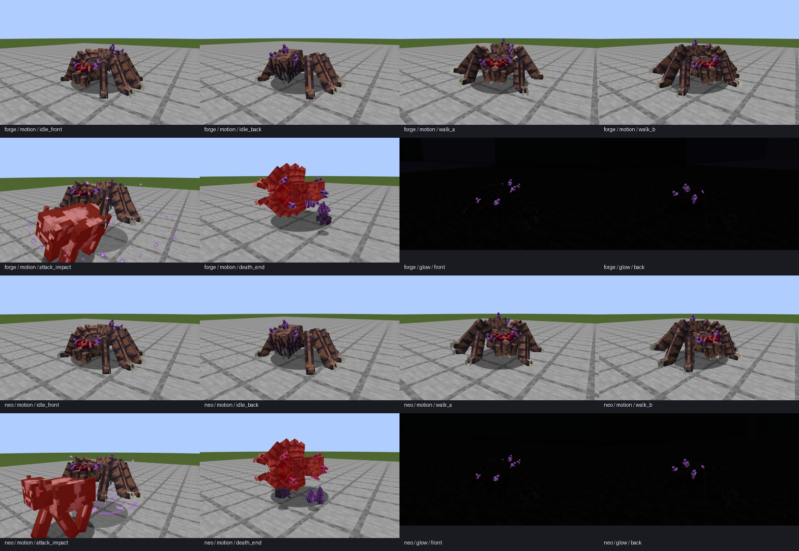

# 畸变蜘蛛双版运行验收

alpha.8 开发增量，2026-11-06。当前公开发行仍为 alpha.7。

| 检查 | Forge 1.20.1 / Java 17 | NeoForge 1.21.1 / Java 21 |
|---|---|---|
| 原生 AI／战斗测试 | 36 项必需测试通过 | 36 项必需测试通过 |
| 运动、攻击、感染与死亡 | 9 张 | 9 张 |
| 零方块光／零天空光 | 前后 2 张 | 前后 2 张 |
| 原始日志、状态与图像哈希 | [Forge 记录](runtime/forge/verification.json) | [NeoForge 记录](runtime/neo/verification.json) |

共 **72 项必需原生测试、22 张最终客户端截图**。行走使用自然落地后的真实寻路；检查实际位移大于 0.05 格。攻击由原有 AI 对原版牛发动，记录蓄力和命中时的真实生命值，确认目标受伤。感染读取现有出场状态，死亡由实际致命伤害触发，分别记录 deathTime 4 和 16。

最初仅设置移动速度的拍摄没有产生位移，随后一次寻路请求在新实体落地前发起而失败；这两次均不计入本记录。最终通过记录使用新的九阶段运行，步态截图来自实际移动，未降低验收条件。

发光房间前后视角分别检查至少 10 个零光探针，并在主体区域检查可见紫晶像素。每一个视角都必须有发光晶体。它证明晶体材质在黑暗中可见；此处不代表动态照亮周围方块。

[总记录](verification.json)封存本体、导出器、运行资源和相关 Java 源码的 SHA256。文本使用 `git-lf` 换行归一；图像及原始日志按字节哈希。[最终双版开发构建](runtime/development/verified-builds.json)记录 JAR 摘要，旁边保留主模组、API 和附属示例构建日志。几何包围盒重叠警告、许可和改造范围见[模型说明](../../colored_units/creature_rework_v2/README.md)。

可重复的客户端入口为两版 Gradle `runClient -PcreatureMotionCheck -PcreatureMotionSubjects=spider` 和 `runClient -PcrystalGlowCheck -PcrystalGlowSubjects=spider`；AI 使用 `runGameTestServer -PriftChecks`。全部使用各工程独立 `build` 世界，不使用玩家的实例或存档。`tools/verify_creature_rework_runtime.py` 检查并封存原始日志和截图。

这是一轮定向开发验收，不能代替公开发布前的 `python tools/build_dual_version.py --clean --gametests`。本轮没有创建公开 alpha.8 发行。
