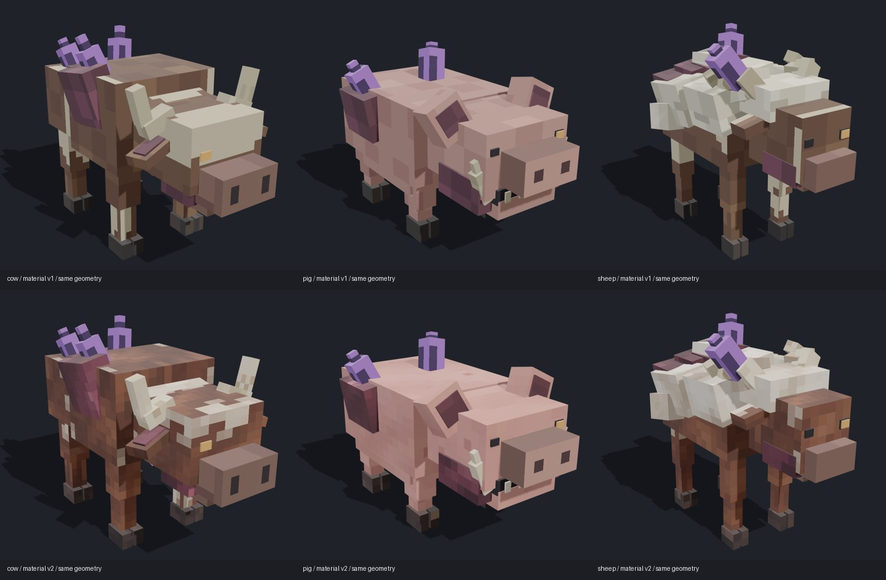
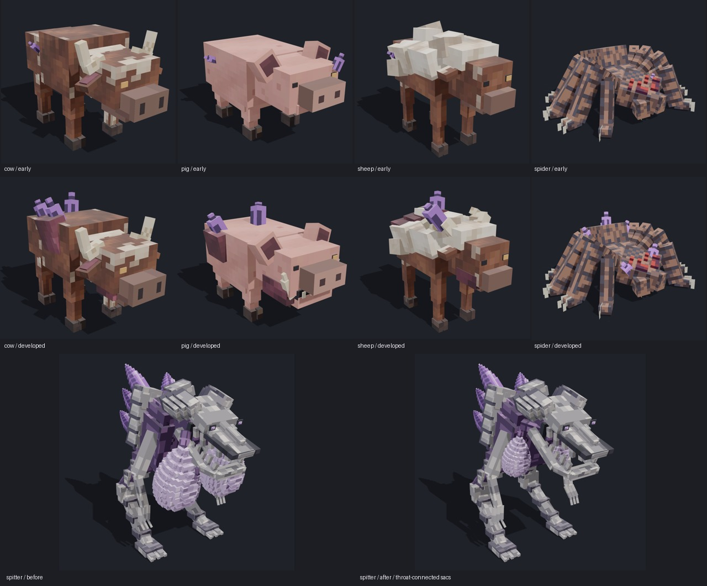

# 贴图细化、初期形态与喷吐者

alpha.8 开发内容，公开发行仍为 alpha.7。本轮对应用户“贴图好看一点”的反馈，并继续完成总目标中的初期形态和喷吐者连接改造。

上排是材质修改前的三只畸变动物，下排是新材质；只用来比较贴图，不能据自动取景推算性能和游戏尺寸。牛、猪、羊的早期与完全畸变形态均已接入同一套细化的物种材质。保留准确的眼／鼻孔像素与原有晶体图像，新增皮毛、皮肤、羊毛、骨、感染组织和蹄壳的像素层次；不要求光影包。内置 imagegen 的完整提示词和保存文件见[材质生成记录](../../colored_units/creature_rework_v2/materials/generation-v2.json)。

早期动物保留完整皮毛和轻度局部感染，完全畸变体保留裂口、背囊和更大的晶体。喷吐者保留原曲面细节，把双囊收回喉部两侧，补充连续接管。五段动作、原命中时点、注册 ID、属性和碰撞体保持；死亡动作在原版移除前完成。[可编辑包、许可与改动范围](../../colored_units/creature_rework_v2/README.md)。

两版原生 AI／战斗各 36 项必需测试。本次客户端覆盖八种形态：三只完全畸变动物、四只初期动物、喷吐者；每只九个阶段和两个零光视角，每版 88 张，合计 **176 张最终实景**。其中行走用真实寻路，攻击原版牛并记录实际生命值下降，感染用原状态，死亡由真实致命伤害触发。羊另外有不掉血的吼叫模式，本次伤害取样场景固定使用它已有的 SLAM，仍由原 AI 发动，未修改普通游戏的随机选招；吼叫功能继续保留。吐射命中图延至实际射出后六 tick，保留飞行时间。

- [Forge 记录](runtime/forge/verification.json)
- [NeoForge 记录](runtime/neo/verification.json)
- [总记录、源码与图像哈希](verification.json)
- [最终开发构建与日志](runtime/development/verified-builds.json)

初次拍摄发现早期猪和蜘蛛的前视晶体被遮挡，已调整为眉／脸侧局部病灶后重新拍摄；前后每一张图都需单独验证可见发光像素。原生光探针的方块光和天空光必须为 0，不能靠提高环境光或远处怪物的晶体通过。最初遮挡截图未计入本次最终 176 张。

复现使用两版 `runClient -PcreatureMotionCheck -PcreatureMotionSubjects=cow,pig,sheep,cow_early,pig_early,sheep_early,spider_early,throat_spitter` 与对应的 `-PcrystalGlowCheck -PcrystalGlowSubjects=...`，封存使用 `python tools/verify_early_texture_runtime.py`。独立测试世界均位于各工程 `build`。本次定向开发验收不代替公开发行前的干净全量门槛；没有据此创建新的公开发行。
