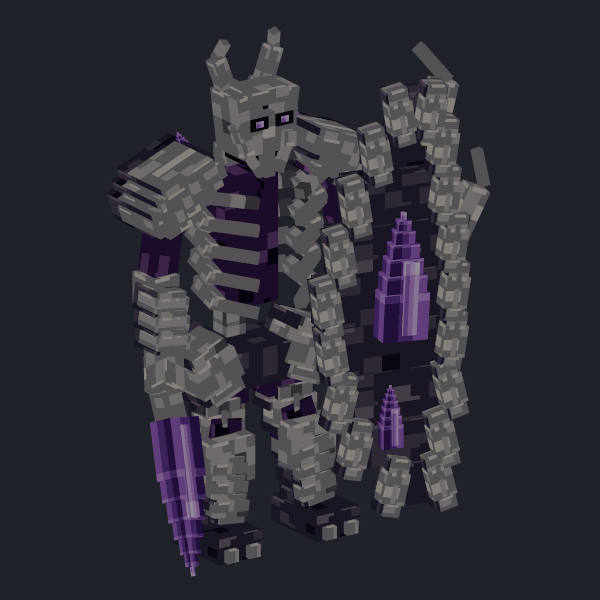
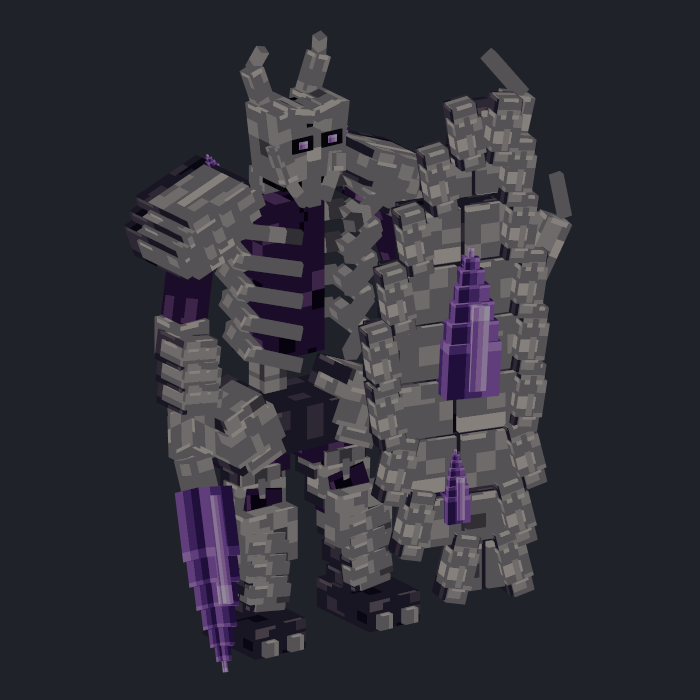
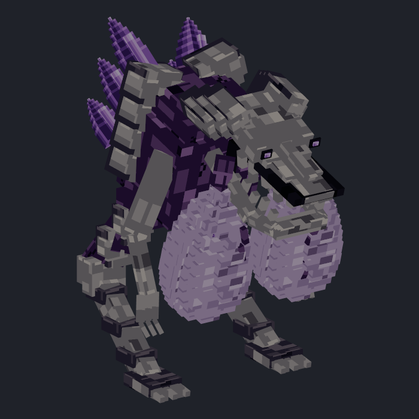
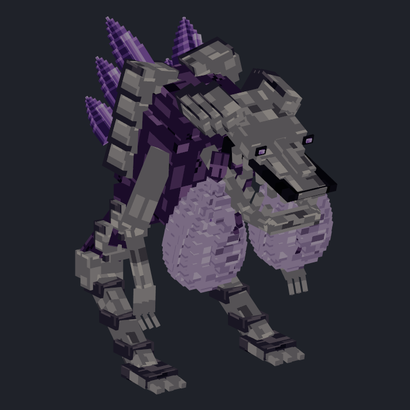

# alpha.6 验收记录

E8 的玩法、坐标、旧世界说明见[收容事故指南](../../docs/containment-incident.md)。本目录的模型前后对比由 Blockbench Headless MCP 渲染；建筑未使用 Blockbench。

| 单位 | 修改前 | 修改后 |
|---|---|---|
| 晶盾卫士 |  |  |
| 裂喉喷吐者 |  |  |

盾面补上分层骨板，保留两簇紫晶和黑色板缝；眉骨改为两侧斜压。喷吐者双囊高度缩短 16%、宽深缩小 8%，连接上端位置保持，UV 按相应轴比例裁取，原贴图没有重绘。晶体暗面、尖端与原色继续保留。

骨骼 UUID 保持不变，左侧骨骼命名移除 `-`；导出器按 UUID 解析动画骨骼，避免 BB5 缓存的旧显示名造成缺失动作。MCP 几何／层级校验与 GeckoLib 命名检查为零错误；仍有薄眼片、晶尖等薄面警告，以及缺少 GeckoLib 项目标识的元数据警告。动作检查保留原有出土和倒地穿过地面的提示，另有原行走／攻击的少量脚底穿地提示；不将这些报告描述为无警告。

原设计参考为[战斗单位设计图](../ender_faction_concepts_2026-11-02/05_combat_units.png)，源模型在 `colored_units/design_pack_2026-11-02_v2/monsters`。MCP 编辑和严格检查记录保存在 `build/incident-alpha6`；服务器测试记录保存在 `build/dual-version-validation`。

最终验收：`python tools/build_dual_version.py --clean --gametests` 通过。两版主 JAR、API 开发包、两版附属示例构建成功；18 组原生测试共 **163 项**（Forge 81、NeoForge 82）通过。另通过每版三次真实服务器启动及区块卸载／重载检查；4 个客户端检查共保存 **32 张**截图。此统计使用最终干净构建，不叠加早期重复运行的测试数。

| 内容 | Forge 1.20.1 | NeoForge 1.21.1 |
|---|---|---|
| 第一波实景 | [查看](forge/incident/wave_one.png) | [查看](neoforge/incident/wave_one.png) |
| 第二波实景 | [查看](forge/incident/wave_two.png) | [查看](neoforge/incident/wave_two.png) |
| 隔离完成 | [查看](forge/incident/isolation_complete.png) | [查看](neoforge/incident/isolation_complete.png) |
| 盾卫游戏效果 | [查看](forge/models/shield_sentinel_front.png) | [查看](neoforge/models/shield_sentinel_front.png) |
| 喷吐攻击效果 | [查看](forge/models/throat_spitter_attack.png) | [查看](neoforge/models/throat_spitter_attack.png) |

[最终校验与 JAR 哈希](final-verification.json)、[完整构建记录](verified-builds.json)、[截图清单](client-verification.json)和 [原生日志](logs) 已保留。两份 JAR 通过 ZIP CRC、版本、E8 清单和当前模型／动画／发光资源一致性检查，5,931 份构建输入在验收期间未改变。

alpha.6 下载与附件见[发布页](https://github.com/fl749731-lab/ender-infection/releases/tag/v0.12.0-alpha.6)。模型依然有上文列出的动作／薄面警告；真实客户端截图用于审阅效果，不表示与概念图已完全一致。
