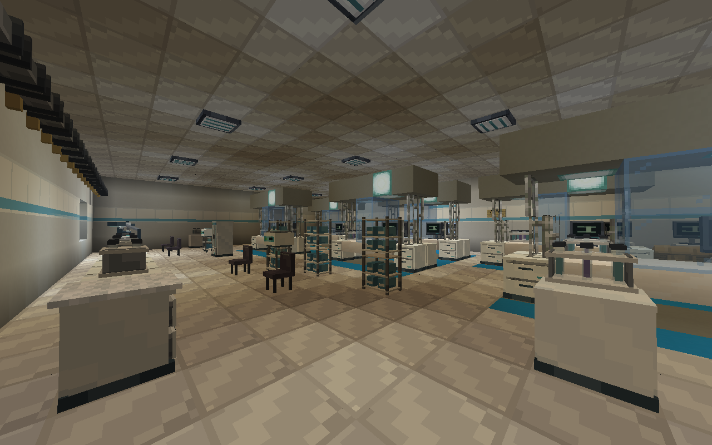
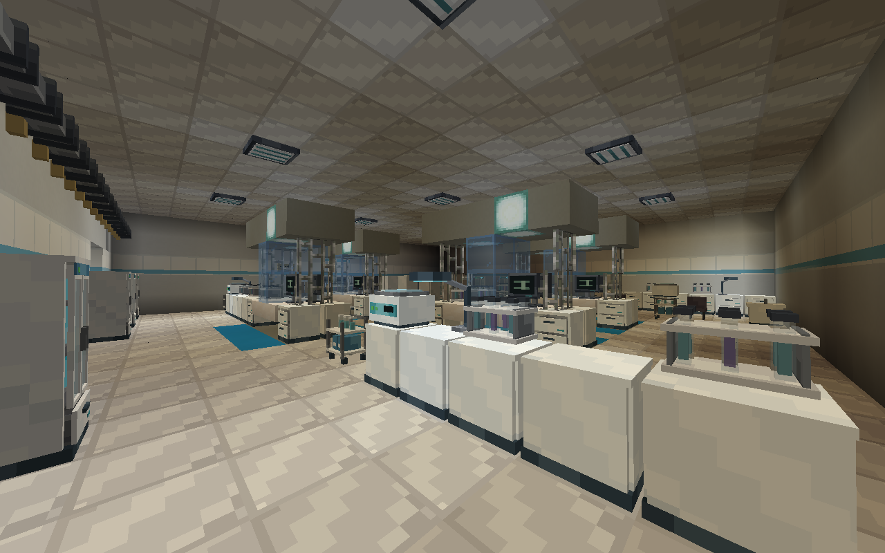
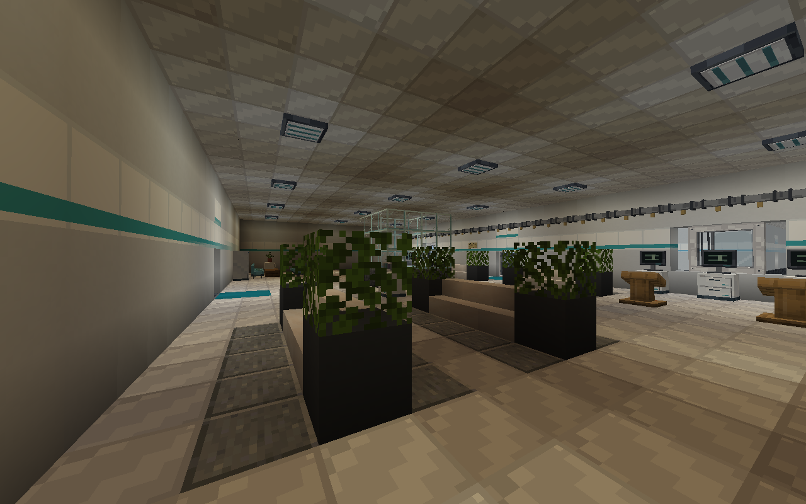

# 中央研究所建筑优化

本目录保存首轮入口和科研区改造的阶段图。当前全房间与 F7 母体结果见[第二轮预览](../institute-rooms-v2/README.md)，本目录旧截图和计数不代表最新资源。

本轮只验证 NeoForge Minecraft 1.21.1，在原 v5 游戏布局上优化入口、中庭、外墙和科研室。共享资源仍沿用仓库的源目录与转换流程。

- 入口：22 格宽的分层门廊，玻璃采光顶、青色导向、发光标牌；移走原路径中间的两根旧雨棚柱。
- 外墙：投影翼片、三道遮阳檐与屋顶设备罩，为长墙增加厚度和分段。
- 中庭：中央镂空的悬挂灯架、两组座椅与绿植，以及独立接待岛地面。
- 科研层：大面积棋盘地面改为浅灰，五间科研室加入 22 组双面实验台。B2 为六组，B1、B4、B5、B8 各四组；每组带双面样本架、显示器、台下冷柜与照明罩，两侧均留操作空间。
- A7 入口大厅：补入四组带绿植的三人座椅，与接待台、展示柜和导览终端形成完整的等候区。

48 间房、10 段楼梯、6 处货梯停靠、原 1417 个储物家具和 48 个补给桶保留；新增 88 个台下冷柜，总计 1505 个储物家具。E8、F8、全部门禁、受控灯具、加工设备和四个主要任务控制器的位置与优化前一致，见 `layout-comparison.json`。

## 源文件与工具

四个原生结构模块位于 `tools/institute_architecture/`，由 `minecraft-structure` MCP 的实际工具调用制作；`tools/create_institute_architecture_mcp.py` 可重建模块，`mcp-authoring.json` 和 `mcp-density-update.json` 保存调用参数、结构哈希和编辑记录。模块沿用旧 DataVersion，经资源转换后在 1.21.1 加载。

模块由 `tools/institute_architecture.py` 接入 `tools/generate_central_institute.py`。常规生成不依赖 MCP 或第三方 Python 包。MCP 小图只用于模块设计；实际游戏中的家具渲染以原生客户端截图为准。

## 验证

独立结构检查已通过：48 房、56 模板、1505 储物家具、48 补给桶、881 受控灯具、170 常亮光源、42 加工设备。检查保留原有门、储物、多方块占位、晶体照明和任务事件检查，新增入口净空、工作岛操作面、灯架中央镂空与科研地面的检查。

NeoForge 完整建筑原生 GameTest 已通过，见 `neoforge-native-test.json`。实际搭建并逐格核验 465049 个方块、1369 个家具占位，验证 1505 个延迟战利品容器及八类战利品；48 间房、楼梯与货梯均可使用，170 处光源和 59 处暴露晶体表面的实际亮度通过。测试保留原亮度断言，新增等待原生异步照明任务完成，避免测试服务器的加速刻提前耗尽等待时间。

NeoForge 可执行 `runClient -ProomVisualCheck`，在独立的超平坦新世界中裁取当前 B2、B4、A7 的完整原生模板，每间从两个角度拍摄。这是房间视觉预览，不代替自然生成验收。原有完整自然生成验收仍保留 61 个镜头；额外传入 `-ParchitectureVisualCheck` 会增加三个近景，共 64 张。

## 当前 1.21.1 实景

三间房、六张 1280×800 原生截图全部完成，记录见 `native-room-preview.json`。采用实际设施的供电状态，截图前验证客户端已收到真实光照；图片未经后期改绘。原始图在 `neoforge/`，MCP 的简化渲染不代表完整的自定义家具模型。

显微分析室 B2，六组双面实验台：

组织培养室 B4，四组双面实验台：

入口大厅 A7，四组新增座椅与既有导览区：

