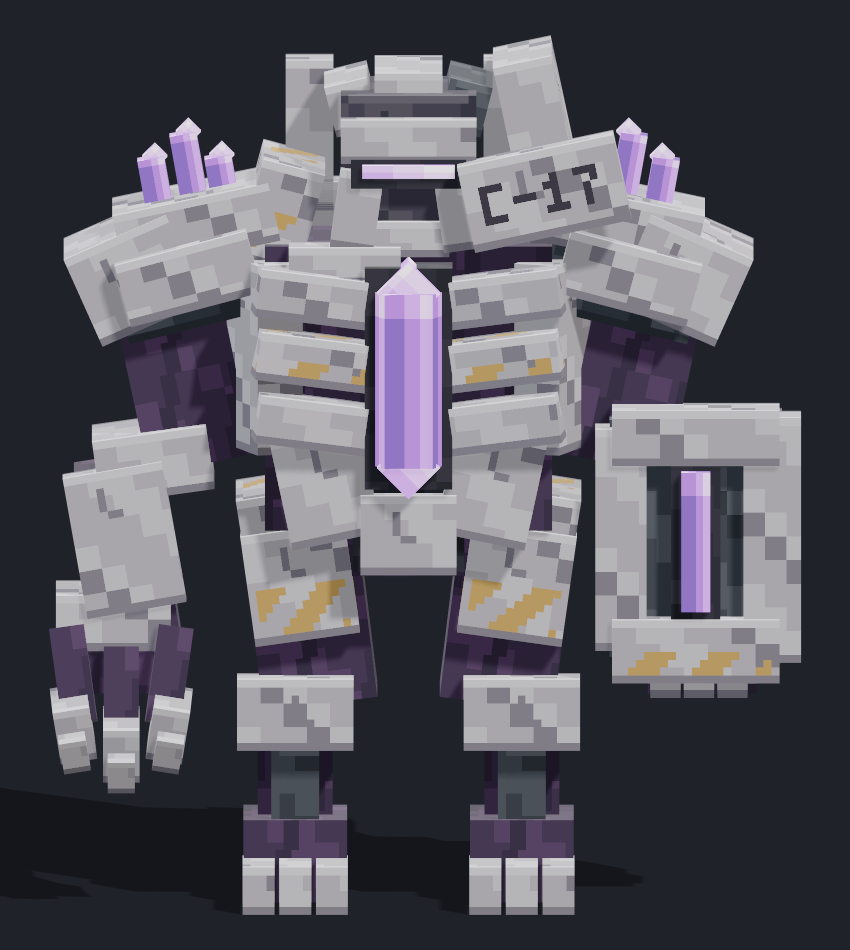
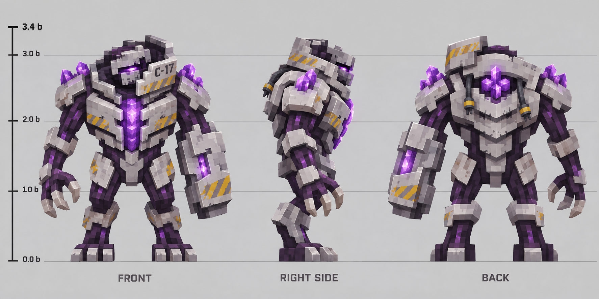

# 收容监管体 · 设计与实模

状态：**模型首版已接入本地 alpha.7；尚未公开发布。** 本页保留三视图和 MCP 模型检查，实际游戏效果见[运行验收](runtime/README.md)。

## 实际模型

[右侧](warden-mcp-right-final.png) · [背面](warden-mcp-back-final.png) · [核心展开](warden-mcp-exposed-final.png) · [爪击侧面](warden-mcp-claw-hit-side.png) · [抬腿蓄力](warden-mcp-stomp-windup.png) · [跪倒](warden-mcp-death-final.png)

## 设计图与对应关系

保留了浅灰装甲、深紫组织、左护臂／右三爪、C-17 高领、肩部和背部晶簇、胸前长条核心与三层背甲。实际模型将曲面切成方块分面，压缩头部、扩大胸口和护臂的可读面积；晶体尖端使用旋转方块表达，细碎裂纹以像素贴图替代。并非逐像素复制设计图。

迭代中已纠正正视图左右护臂方向、胸口晶体叠成串的问题，并把背面大实板改为 U 形固定框。初稿 `v1`／`v2` 截图仅用于过程对照，当前以 `final` 图及可编辑源为准。

## 检查记录

- 几何：0 错误、0 几何警告；自检已执行，非对称护臂／三爪／高领按设计标记。
- GeckoLib 项目元数据：1 条 `geckolib_modid` 警告，编辑器导出路径字段尚未配置。
- 动画：7 段，按每秒 20 次采样；0 错误、0 警告，没有跳过表达式或近似 Bezier。
- 修正了倒地中途脚趾与小腿穿地。检查容差为 0.25 模型单位，即 1/64 格。
- 已查看行走的左右极值、爪击蓄力与出手、跺地抬腿和落地、核心脉冲与展开、倒地中后段。循环端点一致。
- 几何与动画通过 MCP 导出；源与导出契约检查见 `export-validation.json`。
- 导出对照覆盖 168 个关键帧和 156 个发光面；晶体脉冲回落时点已对齐 20 FPS 网格，避免导出时发生取整偏移。

[几何报告](geometry-validation.json) · [动画报告](animation-validation.json) · [导出检查](export-validation.json) · [源模型和贴图](../../colored_units/institute_boss_v1/README.md)

这些是模型与导出检查，不替代游戏运行验收。实体渲染器已接入自发光遮罩，Java 客户端、战斗、多人和存档检查集中在[运行验收](runtime/README.md)。

三视图通过内置 imagegen 生成新图，背景不透明；没有输入参考图片。提示规格见 [concept-prompt.txt](concept-prompt.txt)。模型通过 Blockbench Headless MCP 制作，像素贴图扩展仓库已有图集生成器。未导入其他模组的模型或贴图。
