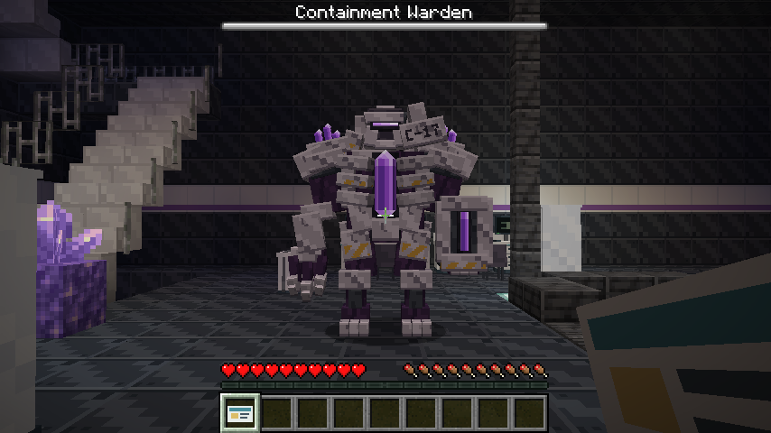

# F8 收容监管体 · 游戏验收

对应本地开发版 **0.12.0-alpha.7**，尚未公开发布。双版验收通过，最终 JAR 摘要见[最终记录](final-verification.json)。

| 项目 | 结果 |
|---|---|
| 最终原生测试套件 | 20 组，共 197 项必需测试通过 |
| F8 专项 | 每版 17 项，包含不手动指定目标的生存玩家自动选敌与命中 |
| E8／F8 存档 | 共 12 次专用服务器启动，覆盖实际区块卸载与重载 |
| 原生客户端 | 每版 18 张，共 36 张实景与交互截图 |
| 公共 API 与附属示例 | API v1 保持兼容，两版示例构建及原生测试通过 |

最终套件集采用两版最新的 17 项 F8 测试结果，其余 18 组沿用完整干净回归结果。完整回归初始记录为 195 项，加入两版各一项自动选敌测试后为 197 项。[完整回归收据](full-gate.json)与[最终记录](final-verification.json)分别保留对应范围；最终打包另核对了模型、贴图、数据目录与 Java 字节码版本。

## 实际客户端

Forge 1.20.1 / Java 17 与 NeoForge 1.21.1 / Java 21 均已完成独立新世界流程，各保留 18 张原生截图。场景使用实际 F8 的六个裁剪结构片；模型、贴图、动画、血条、终端使用包、领奖库存和核心冷却均来自游戏运行。



| 画面 | Forge | NeoForge |
|---|---|---|
| 正面与血条 | [查看](forge/warden_front.png) | [查看](neoforge/warden_front.png) |
| 侧面／背面 | [侧面](forge/warden_side.png) · [背面](forge/warden_back.png) | [侧面](neoforge/warden_side.png) · [背面](neoforge/warden_back.png) |
| 夜间紫晶发光 | [查看](forge/warden_night_glow.png) | [查看](neoforge/warden_night_glow.png) |
| 行走 | [查看](forge/warden_walk.png) | [查看](neoforge/warden_walk.png) |
| 爪击蓄力／出手 | [蓄力](forge/warden_claw_windup.png) · [出手](forge/warden_claw_hit.png) | [蓄力](neoforge/warden_claw_windup.png) · [出手](neoforge/warden_claw_hit.png) |
| 跺地蓄力／落地 | [蓄力](forge/warden_stomp_windup.png) · [落地](forge/warden_stomp_hit.png) | [蓄力](neoforge/warden_stomp_windup.png) · [落地](neoforge/warden_stomp_hit.png) |
| 晶体爆发 | [查看](forge/warden_burst.png) | [查看](neoforge/warden_burst.png) |
| 核心暴露 | [查看](forge/warden_core_exposed.png) | [查看](neoforge/warden_core_exposed.png) |
| 倒地 | [查看](forge/warden_death_kneel.png) | [查看](neoforge/warden_death_kneel.png) |
| 领奖与背包 | [提示](forge/warden_reward_claimed.png) · [背包](forge/warden_inventory.png) | [提示](neoforge/warden_reward_claimed.png) · [背包](neoforge/warden_inventory.png) |
| 核心使用冷却 | [查看](forge/warden_core_cooldown.png) | [查看](neoforge/warden_core_cooldown.png) |

[Forge 截图摘要](forge/verification.json) · [NeoForge 截图摘要](neoforge/verification.json)

## 检查范围

原生测试覆盖研究和门禁前置、实际 F8 结构、独立抑制台、暴露与冷却时限、三个技能的真实 AI 和伤害时点、掩体／离开范围／跳跃躲避、和平暂停、多人重复触发、失效身份恢复、无强制加载、旧存档及核心道具。

专用服务器检查采用每版三个独立进程：先保存活动 Boss，再重启并实际卸载／重新加载所在区块，击败领奖后再次重启检查领奖状态。身份、血量和第一座抑制台状态都需保留，缺失实体不能触发自动补刷或领奖。

客户端验收中的研究前置由测试场景预置，静态截图会冻结 AI，攻击截图会把移动速度设为零以保持机位，最后击杀使用测试伤害。终端放电、领奖和道具使用通过真实客户端包执行。原生服务端测试独立检查 AI、伤害和前置，截图不替代这些测试。

这些检查不构成长时间多人服压力测试，也不自动更新玩家已有世界中的旧研究所。可编辑模型仍保留一条缺少编辑器 `geckolib_modid` 字段的警告；运行时使用显式资源路径。

## 复现

在对应工程使用该版本 JDK：

```text
gradlew.bat runGameTestServer -PwardenChecks
gradlew.bat runClient -PwardenVisualCheck
```

客户端世界与截图位于工程 `build/warden-visual-check`。完整检查在仓库根目录运行 `python tools/build_dual_version.py --clean --gametests`，包含两版 Boss 与 E8 的真实服务器重启测试。截图收集使用 `tools/verify_warden_visual.py`。

[操作指南](../../../docs/institute-boss.md) · [三视图与 MCP 模型](../README.md)
