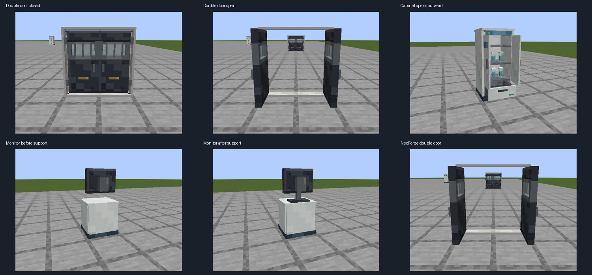

# alpha.7 家具与双开门实景

2026-11-06，Forge 1.20.1 / Java 17 与 NeoForge 1.21.1 / Java 21。对应用户提交的储柜内穿门板、接待台悬空显示器和并排门问题。

## 已修复

- 储柜、玻璃柜、低温柜与服务器柜根据实际铰链朝柜外开门；柜内层板和设备不随门板旋转。
- 同类、同朝向的相邻两扇研究所门，自动使用镜像外侧铰链、连贯上下框和没有中柱的双门造型；任意一侧上／下半部同步开关。
- 单门保留原造型；三门连排、不同朝向／材质或不同门禁标记不混配。配对门同时验证两侧设施门禁，保留室内应急出口。
- 接待台使用的显示器增加落台底座与连续支杆，保留背面壁挂连接结构。柜子与库存 ID、既有门和已放置显示器直接沿用。

## 原生证据

| 验收 | Forge | NeoForge |
|---|---|---|
| 家具／门原生客户端视图 | [22 张与原始日志](runtime/forge/verification.json) | [22 张与原始日志](runtime/neo/verification.json) |
| 储物与配对行为 | 8 项必需测试通过 | 8 项必需测试通过 |
| 设施操作与配对门禁防绕过 | 6 项必需测试通过 | 6 项必需测试通过 |

[4 组、28 项定向原生测试的摘要和日志哈希](runtime/native/verification.json)。每个客户端记录四朝向普通双门开／关、侵蚀双门、独立单门、四种样本柜、服务器柜、隔帘和接待台前后面，共 **44 张最终截图**。柜子由真实服务器箱子菜单的查看者保持开启；客户端等待状态同步和区块网格编译后截图，不用静态 OPEN 贴图替代门扇动作。

显示器修改前的 Forge [前面](before/reception_front.png)／[背面](before/reception_back.png)仅作为悬空问题基线，不计入最终 44 张。最终对照为 [Forge 背面](runtime/forge/reception_back.png)／[NeoForge 背面](runtime/neo/reception_back.png)。

截图检查模型和开闭姿态；碰撞与门禁以原生测试为证。发布 JAR 还须执行干净双版本全量门槛，最终数量与 JAR SHA256 以发行附件为准。本记录不把先前中止的发版验证计作完成。

[玩家用法、坐标示意与导出入口](../../docs/lab-fixtures.md)
