# alpha.5 模型与实机验收记录

本目录记录 **0.12.0-alpha.5** 的模型修正与实机验收。发布附件见 [alpha.5](https://github.com/fl749731-lab/ender-infection/releases/tag/v0.12.0-alpha.5)。本页图片全部来自本项目原创模型，PNG 从原截图逐字节复制，未重绘、裁剪或调色，也未收录外部模组图片。

实际范围为**两只修正、两只恢复外观**：

| 单位 | 本轮实际状态 | 命中／释放与总长 |
|---|---|---|
| 破城巨像 | 恢复层叠骨甲，修正低伏、分裂骨壳面部，保留新攻击动作 | 22／58 tick |
| 孢翼侦察者 | 修正扇形翼膜、短吻和单主尾；孢囊移至后腹，并缩至原尺寸的 **82%**，即各方向尺寸减少 **18%** | 14／36 tick |
| 晶盾卫士 | 恢复修改前的外观，保留新攻击骨骼与动作 | 18／44 tick |
| 裂喉喷吐者 | 恢复修改前的外观，保留新攻击骨骼与动作 | 24／52 tick |

喷吐者与侦察者在表中时刻释放三弹齐射，实际伤害还取决于飞行时间。其他十种设计单位保持 16／40 tick。

## Blockbench MCP 原生截图

以下图片展示已保存的可编辑模型与 UV，不是 Minecraft 实机画面。`mcp/before` 是本轮修改前、用于发布前对照的外观基线；`mcp/final` 是最终修正样板或恢复外观后的截图。

### 破城巨像

| 修改前基线 | 最终正面 | 最终侧面 |
|---|---|---|
| 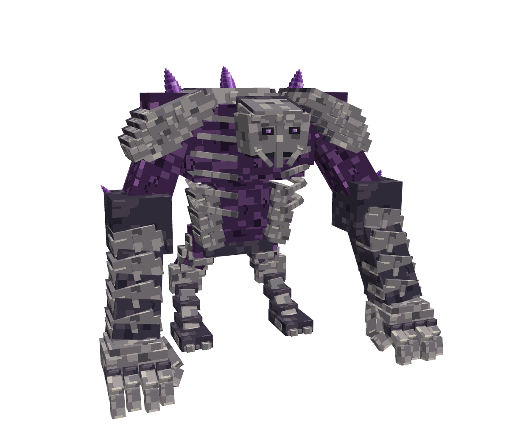 | 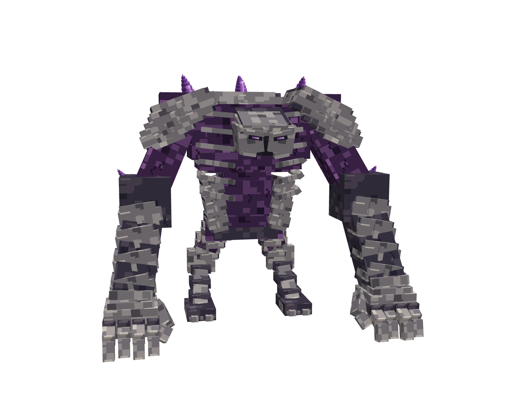 | 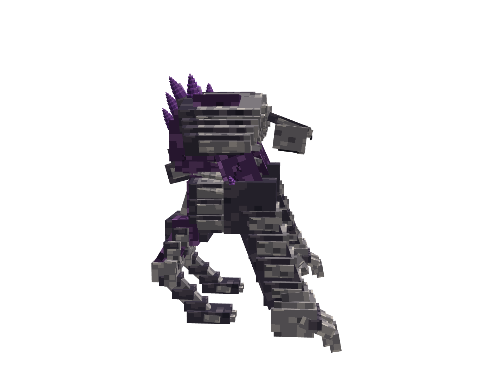 |

### 孢翼侦察者

| 修改前基线 | 最终斜前方 | 最终侧面 |
|---|---|---|
| 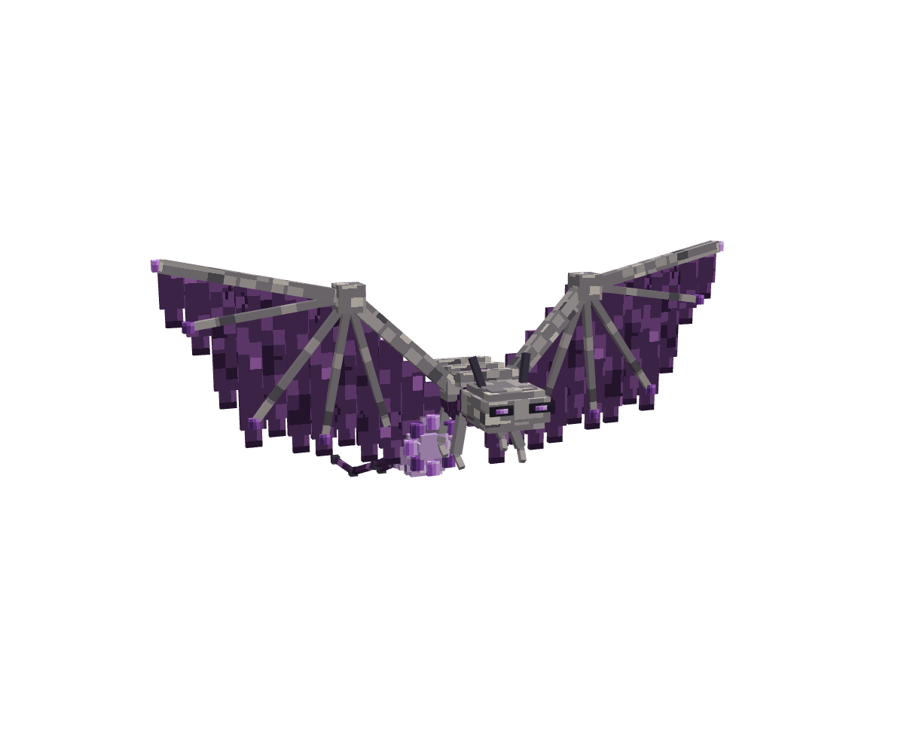 | 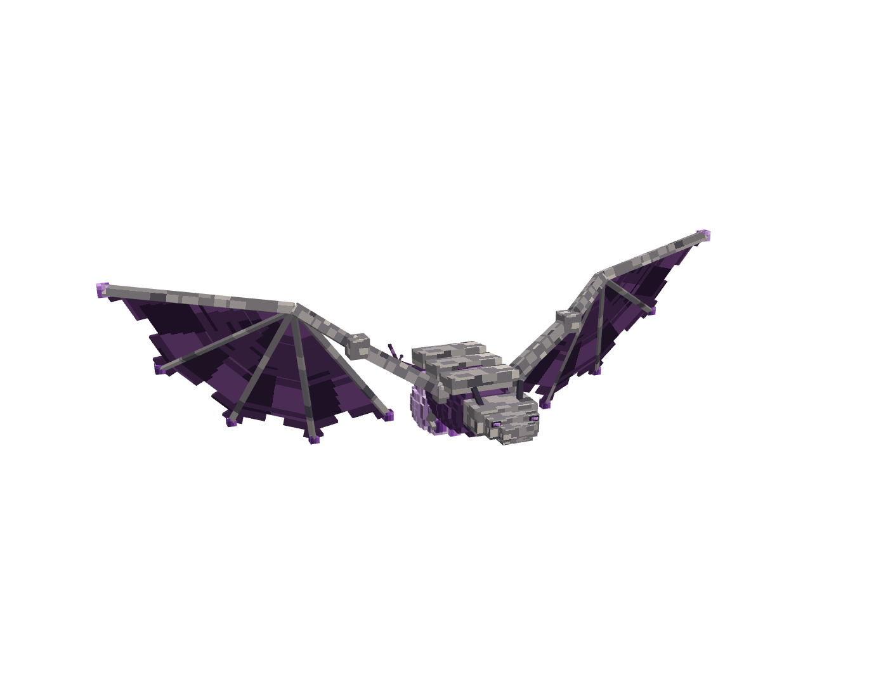 | 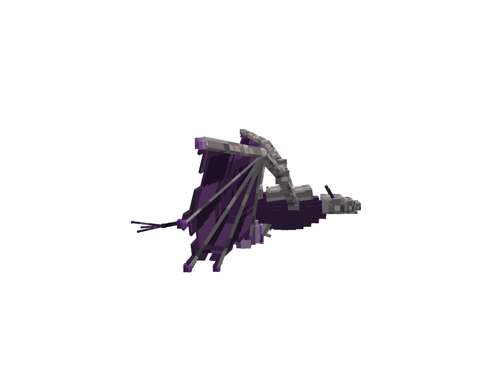 |

孢翼前后图的相机角度不同，供轮廓与器官位置参考；原图保持不变。

### 恢复外观的两只单位

| 晶盾卫士 | 裂喉喷吐者 |
|---|---|
| 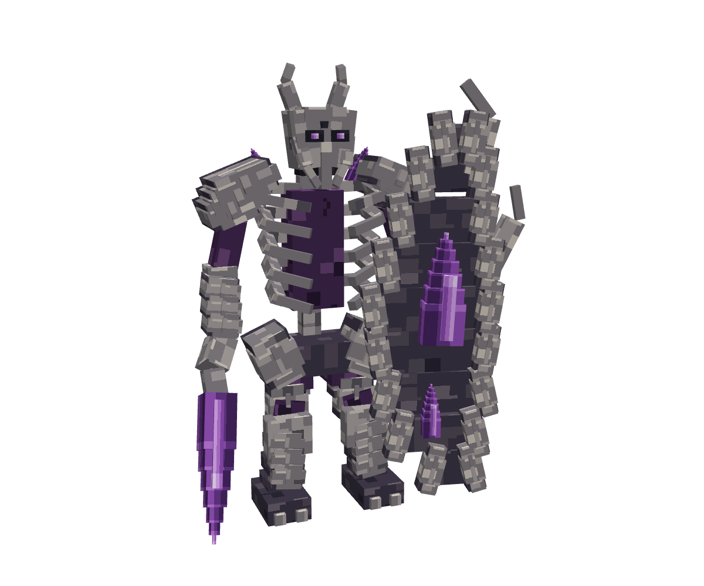 | 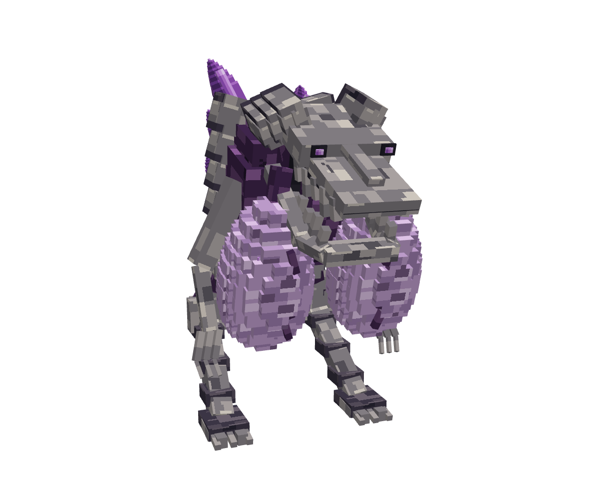 |

## Minecraft Forge 1.20.1 实机截图

以下四张来自 Forge 的独立 `build/concept-check` 客户端，与上方 MCP 图片分开保存。本轮四个单位的正面、背面、蓄力及命中共 16 张截图流程已完成；此处收录四张正面，作为运行资源的形体与 UV 证据。

| 破城巨像 | 孢翼侦察者 |
|---|---|
| 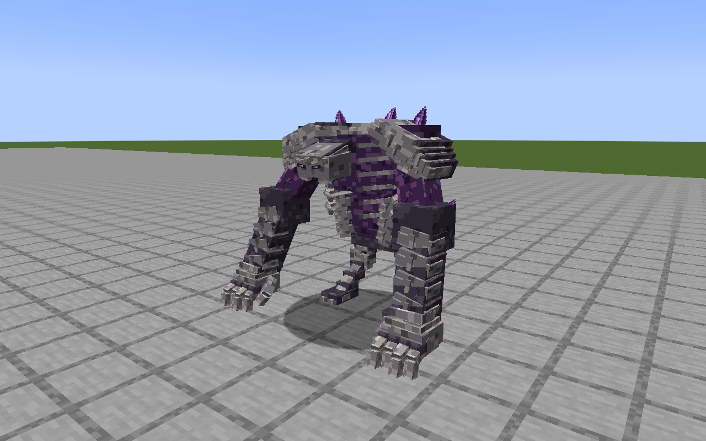 | 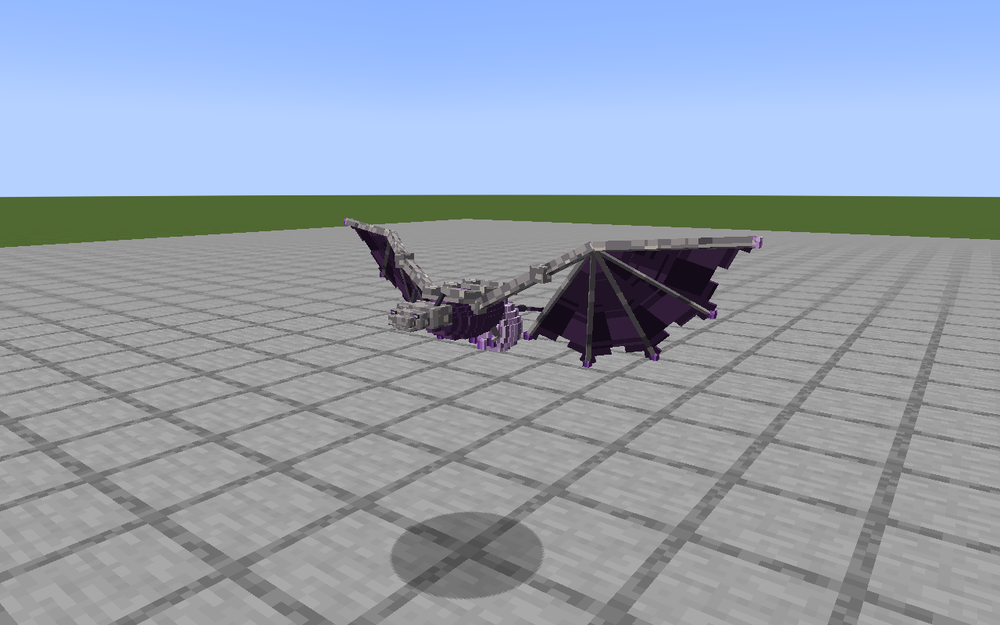 |

| 晶盾卫士 | 裂喉喷吐者 |
|---|---|
| 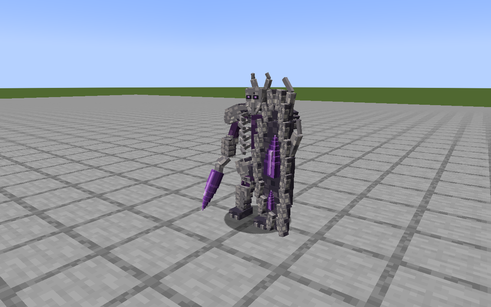 | 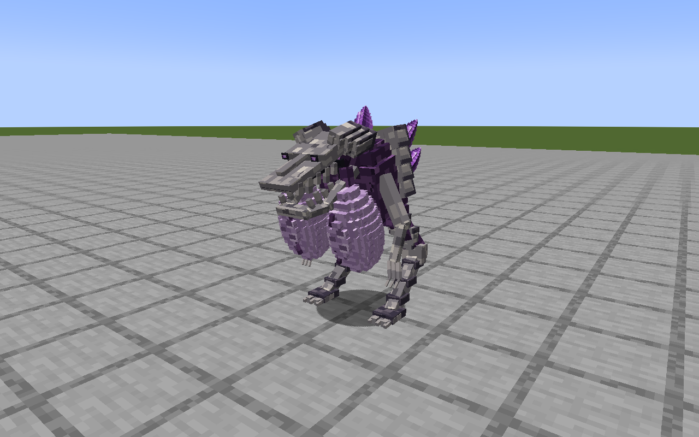 |

## Minecraft NeoForge 1.21.1 实机截图

以下两张来自 NeoForge 独立 `build/concept-check` 客户端，分别展示孢翼稳定飞行姿态与巨像抬臂蓄力；原始 PNG 与验收记录中的 SHA256 一致。

| 孢翼正面 | 巨像抬臂蓄力 |
|---|---|
| 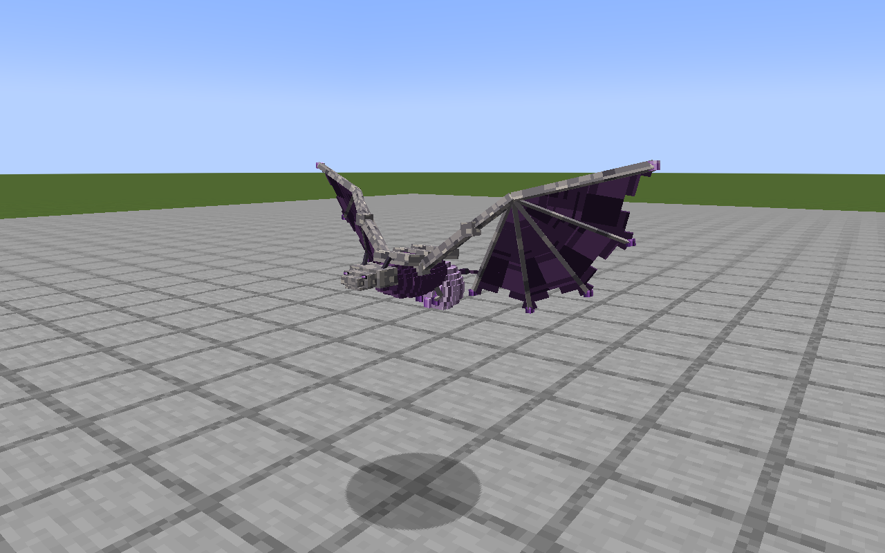 | 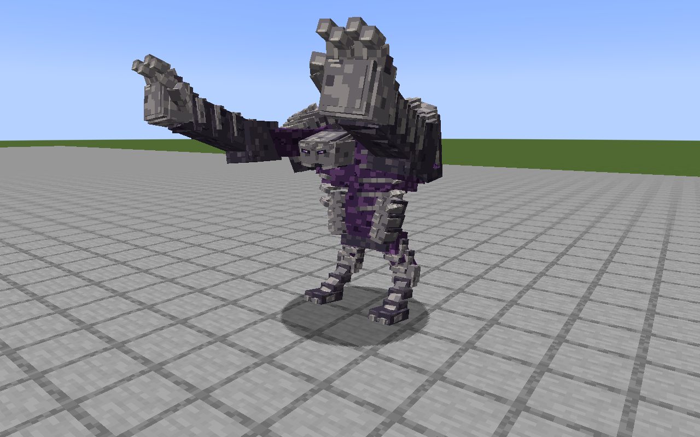 |

## 本轮本地验收结果

本轮增量验收状态为 **PASS**，两版主 JAR 的 `build` 与 `apiDevJar` 成功。

| 验证内容 | Forge 1.20.1 | NeoForge 1.21.1 | 合计 |
|---|---:|---:|---:|
| 默认原生回归 | 98 | 99 | 197 |
| 裂隙与 AI 原生回归 | 36 | 36 | 72 |
| 原生测试总计 | 134 | 135 | **269** |
| 四怪姿态截图 | 16 | 16 | 32 |
| 零环境光暗室截图 | 8 | 8 | 16 |
| 研究所操作截图 | 10 | 10 | 20 |
| 设备细节截图 | 4 | 4 | 8 |
| 客户端截图总计 | 38 | 38 | **76** |

[validation-summary.json](validation-summary.json) 保留本轮验收来源、各项日志路径、计数及两版主 JAR 的 SHA256；仓库只收录精简摘要与选定截图。完整双版本干净构建、API 开发包与附属示例构建已经通过，16 组原生测试共 147 项必需测试通过。

## 保存记录与来源

[final-verification.json](final-verification.json) 是 MCP 源文件冻结时的校验记录副本，仅将四个 `source` 绝对路径改为仓库相对路径，其他字段和 SHA256 均保留。记录包含模型及配套 PNG 的 SHA、内嵌贴图一致性、紫晶像素与 UV 保留情况、攻击关键帧和总长。`productionExportPerformed: false` 描述源冻结时的阶段；后续两版实机证据列在上节。

原始采集位置（均相对于仓库根目录）：

- 最终巨像与孢翼：`build/mod-research-2026-11-05/native-correction/final-samples/`。
- 恢复外观的盾卫与喷吐者：`build/mod-research-2026-11-05/native-correction/restored/`。
- 修改前基线：`build/mod-research-2026-11-05/native-polish/before/`。
- Forge 实机图：`ender_infection_colored/build/concept-check/screenshots/`。
- NeoForge 实机图：`ender_infection_neoforge/build/concept-check/screenshots/`。

截图使用隔离开发世界，不读取玩家已有实例或存档。本轮日志与原始验收记录保留在 `build/model-polish-alpha5/`。
