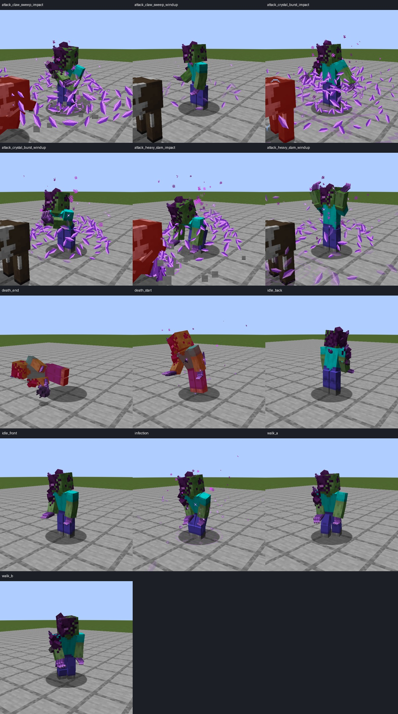
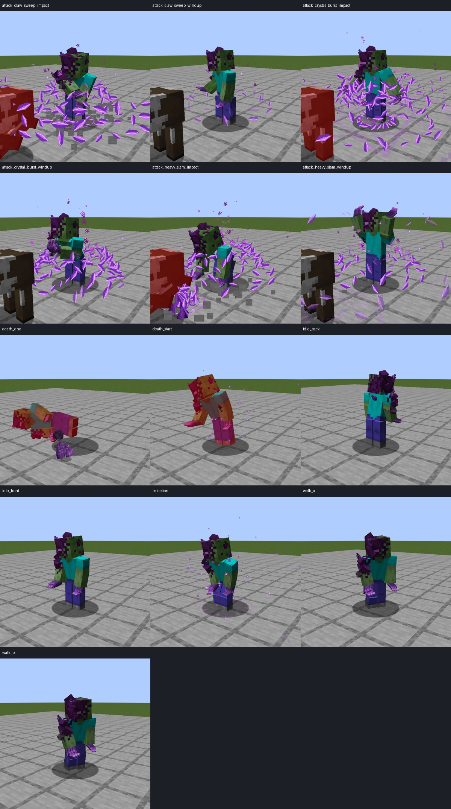

# 公开僵尸底模：双版实景验收

2026-11-06，alpha.8 开发分支。采用 [Purple zomie — @elma_taburlas](https://blockbenchworkshop.com/model/elma_taburlas/purple-zomie)，[CC BY 4.0](https://creativecommons.org/licenses/by/4.0/)，源和修改说明见[模型包](../../colored_units/mutant_zombie_public_v1/README.md)。保留原皮肤和衣物图案，去枪、分节晶爪、肘膝关节与七段动作已经接入真实客户端。

| 检查 | Forge 1.20.1 | NeoForge 1.21.1 |
|---|---|---|
| 原生 AI / 裂隙用例 | 36 项必需测试通过 | 36 项必需测试通过 |
| 客户端动作 | 13 张，真实行走、三种攻击、感染、死亡 | 13 张，相同场景 |
| 暗室发光 | 前后两面；每面 10 处方块光／天空光均为 0 | 前后两面；相同探针 |
| 主模组、API、附属示例 | 构建通过 | 构建通过 |

攻击截图的靶牛初始生命为 100，横扫后 90、重砸后 84、晶体爆发后 88；蓄力阶段仍为 100。场景通过反射调用原有 `startAttack` 确定招式，随后由真实服务端 tick 结算伤害；不是任意播放动画后假定伤害成功。日常选敌及 AI 行为另外运行了既有原生用例。行走场景使用真实导航并要求发生位移；感染用实际存档状态启动；死亡用实际致命伤害和第 4／16 tick 捕获。

这些图是同一模型在实际客户端的裁切联系表。未经裁切的 30 张 PNG 和 6 份运行日志在 `runtime/{forge,neo}`；完整截图哈希、移动距离、生命变化和光照检查记录在对应 `verification.json`。死亡截图的红色来自游戏受伤效果，不是贴图色变。当前普通晶片粒子的密度仍沿用现有实现，继续列入其余特效改造范围。

18 项 Python 导出回归也通过；MCP 七段动画在 48 Hz 下 0 错误／0 警告。几何检查的 22 个警告为 16 处相接骨骼包围盒重叠及 6 处刻意不对称，详细内容保存在模型包内。

开发构建收据和四份构建日志在 `runtime/development`。`tools/verify_mutant_runtime.py` 同时核对 JAR 哈希与包内几何、动画、贴图、发光、署名和视觉边界，防止拿旧包配新截图。顶层 `verification.json` 锁定模型、导出、运行时代码、资源及校验器。

这是一组增量开发验收，`release_gate=false`；没有执行新的干净公开发布门槛，也没有创建新公开发行。公开下载仍为 v0.12.0-alpha.7。
