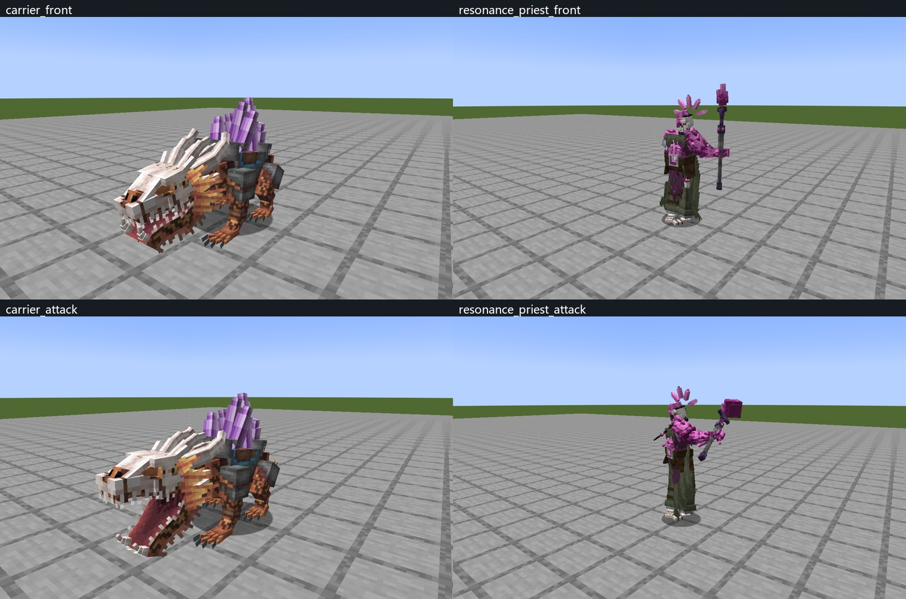

# 模型第一批改造与全体评审

开发版本 0.12.0-alpha.7；尚未公开发布。共鸣祭司与晶背搬运兽已改造并接入两版；其余对象的评审结论和改造顺序见[统一说明](../../docs/model-visual-review.md)。

本轮本地验收：两版各 36 项相关必需原生用例，共 72 项；196 张客户端视图；两版主模组、API 包及附属示例构建通过。

## 检查范围

| 内容 | 本轮证据 |
|---|---|
| 全部怪物 | 36 个外观 × 正面、侧面、背面、行走和攻击姿势，180 张 MCP 检查图；[基线清单与摘要](audit/manifest.json) |
| 第一批改造 | 祭司 299 方块／91 骨骼；搬运兽 191 方块／142 骨骼；各有待机、行走、技能、感染、死亡五动作 |
| MCP 验证 | 两只模型的结构门槛及待机、行走、技能的 24 Hz 采样；接地修正后无采样穿地警告；[原生记录](../../colored_units/public_model_adaptations_v1/mcp-verification.json) |
| 独立模型与装备 | 四把设计武器、两套设计甲，各四视图；[图册](audit/equipment.jpg) |
| 基础装备 | 共振刃、三系剑／斧与九工具的模型类型和贴图；另检查三系晶甲的 Java 几何及客户端前后穿戴视图 |
| 普通／Boss 特效 | 检查七类效果的 13 张材质及渲染实现；普通冲击环仍为平面，监管体已有独立立体浪；未宣称重做所有特效 |

## 双版客户端

- [Forge 模型动作验收](runtime/forge/concept/verification.json)与[NeoForge 模型动作验收](runtime/neo/concept/verification.json)：每版两只、各四视图，共 16 张。实际同步触发技能动画，核对待机、背面、预备和攻击姿势。
- [Forge 暗室验收](runtime/forge/glow/verification.json)与[NeoForge 暗室验收](runtime/neo/glow/verification.json)：每版 35 形态、前后各一张，共 140 张；每张的方块光／天空光探针均为零。涵盖七种初期感染、七种畸变及母体五阶段等，监管体延用本轮之前的独立实景验收。
- [Forge 额外装备视图](runtime/forge/equipment/verification.json)与[NeoForge 额外装备视图](runtime/neo/equipment/verification.json)：每版三套晶甲的前后面与十四只设计生物，共 40 张。不是完整的全姿势穿戴测试。

暗室按每只生物的前后成对视图核对晶体可见性，像素检测排除背景其他怪物。畸变羊、畸变蜘蛛、初期骷髅、初期僵尸的部分正面及掘地者背面有晶体被本体挡住，记录为视角遮挡；不是把它们的晶体材质取消发光。皮肤、金属与骨甲保持常规受光，自发光不产生世界光照。

## 构建与测试

[最终开发验收摘要](runtime/final-verification.json)记录本轮源码／资源摘要、实际原生用例数、客户端记录和开发 JAR SHA-256。两版主模组、API 开发包与附属示例都构建；相关 Rift / 晶体装备 / 设计怪物测试逐版运行，并检查实际执行数。另有五项新图集／骨骼／循环契约回归与六项既有导出回归。

尾部及眼部循环接点在首次全体暗室／装备采集后修正，两模型四条循环的首尾通道差均为零。几何、基础贴图和发光贴图的 SHA-256 前后完全相同；暗室材质验证继续适用。修改后的两只模型另在两版客户端重拍动作视图，最终 JAR 使用修正后的动画。

这是开发增量验收。没有在本轮重新执行完整发布门槛中的全部研究所服务器重启／区块卸载流程；公开发布仍需 `python tools/build_dual_version.py --clean --gametests`。历史 197 项用例或更早的通过记录没有计入本轮。

## 维护入口

`colored_units/public_model_adaptations_v1/models` 为可编辑源；`mcp_exports` 为 MCP 原生导出；许可和作者来源保留在[模型包](../../colored_units/public_model_adaptations_v1/README.md)。导出锁防止改了源却继续用旧产物。

资源入口：`python tools/export_design_assets.py --units carrier,resonance_priest`；验证：`python tools/export_public_model_adaptations.py --verify`；随后运行 `python tools/sync_neoforge_resources.py`。Neo 生成资源不手改。

全体评审图是替换前的基线。根目录两只模型的六姿势 PNG 是修改后的 MCP 预览；`runtime` 下均为真实 Minecraft 截图。基础武器仍有薄片轮廓、两套设计甲仍过于相似、四足畸变仍有盒状体块；这些问题已明确列入下一批，未冒充已修完。
