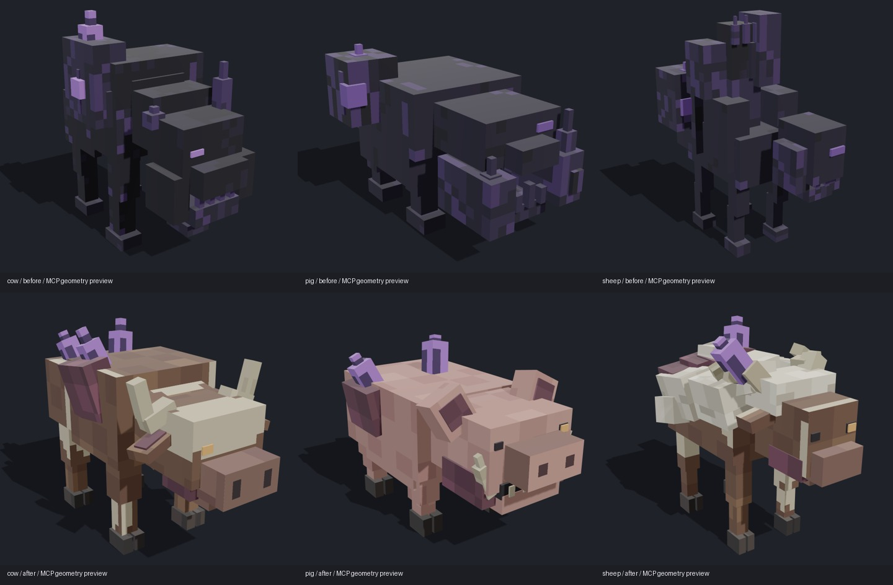
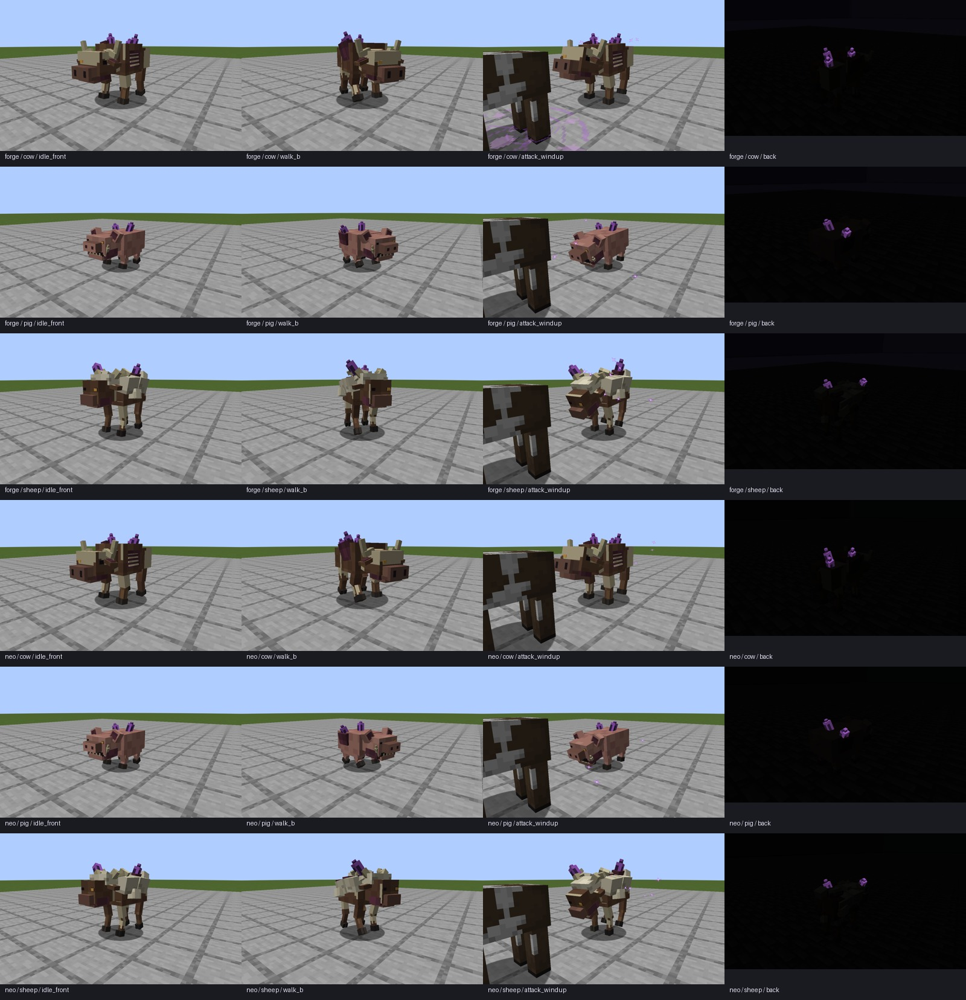

# 牛、猪、羊的本体与动作验收

alpha.8 开发内容；当前公开发行仍为 alpha.7。

上排是旧模型，下排是改造后模型。此图用于比较轮廓、物种特征和材质，不代替下面的原生游戏验收；各模型自动取景，不能据此推算游戏内尺寸或性能。

三种动物在项目原有模型上通过 MCP 改造，保留原 ID、伤害、范围、属性及碰撞体。牛恢复双角、宽鼻、耳尾和毛色，猪收回下颌并恢复猪鼻与耳朵，羊恢复羊毛、羊脸和卷角并压低背囊。三只均有真实膝关节、分蹄、独立耳／尾／颌及五段动作。没有导入许可只允许展示的公开候选。具体来源、取舍和几何警告见[可编辑包](../../colored_units/creature_rework_v2/README.md)。

| 原生检查 | Forge 1.20.1 / Java 17 | NeoForge 1.21.1 / Java 21 |
|---|---|---|
| AI／战斗必需测试 | 36 项通过 | 36 项通过 |
| 三只的待机前后、行走两相、蓄力、命中、感染、死亡前后 | 27 张 | 27 张 |
| 三只各前后两个零光视角 | 6 张 | 6 张 |
| 状态、原始日志与截图哈希 | [Forge 记录](runtime/forge/verification.json) | [NeoForge 记录](runtime/neo/verification.json) |

总计 **72 项必需原生测试、66 张最终实景**。行走使用自然落地后的真实寻路，要求两相实际位移均大于 0.05 格。攻击由原有 AI 对原版牛发动，分别在每种怪物的蓄力和命中后取样，要求目标生命值实际下降；未将手动播放动画当作 AI 攻击通过。感染读取原有出场状态，死亡以致命伤害触发并记录 deathTime 4／16。各阶段使用新实体，清理前一阶段掉落物，避免其他动物的掉落混入画面。

暗室前后每个视角均记录至少 10 个方块光／天空光为 0 的探针，且主体区域必须有可见发光晶体。这里验证晶体材质可见，不把自发光等同于照亮周围方块。

[总封存记录](verification.json)绑定可编辑源、MCP 导出、运行资源和两版相关 Java 源码；文本使用 `git-lf` 哈希，图像／原始日志按字节封存。[开发构建](runtime/development/verified-builds.json)及同目录日志记录双版主模组、API 与附属示例。此前蜘蛛验收为另一轮历史记录，本轮不将它的旧截图混入 66 张。

复现入口：两版 `runGameTestServer -PriftChecks`、`runClient -PcreatureMotionCheck -PcreatureMotionSubjects=cow,pig,sheep`、`runClient -PcrystalGlowCheck -PcrystalGlowSubjects=cow,pig,sheep`；封存使用 `python tools/verify_quadruped_runtime.py`。所有测试使用各工程 `build` 下的独立世界。

这是定向开发验收，不替代公开发版前的干净全量门槛。当前只检查平整测试场景，复杂地形的足部贴合继续复核；初期感染、畸变僵尸、其他怪物、装备和普通特效仍在总目标中。
