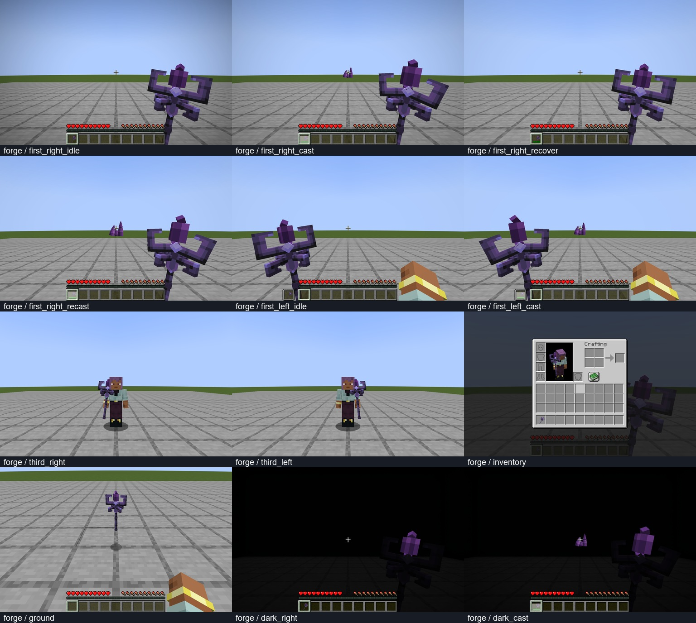

# 共振法杖公开底模：两版开发验收

采用 [@alexander 的 Void Staff](https://blockbenchworkshop.com/model/alexander/void-staff)，许可为 [CC BY 4.0](https://creativecommons.org/licenses/by/4.0/)。保留原杖体的几何和绘制纹理，改造紫晶核心、活动叉臂、握点和施法动画。[可编辑源及改造说明](../../colored_units/resonance_staff_public_v1/README.md)。

本次只更新 `resonance_staff` 的外观和渲染；原 `DesignWeapon` 仍负责技能、伤害、耐久和冷却。模型由 28 方块、4 骨骼组成，包含四秒待机与一秒施法。使用服务器触发、逐物品栈同步的动作；修复耐久／动画 ID 同步让施法中的法杖下沉的问题。

| 验收 | 结果与范围 |
|---|---|
| Forge 1.20.1、NeoForge 1.21.1 实景 | 每版 12 帧：左右手、释放／恢复／再次释放、第三人称左右手、背包、掉落物、暗室待机与施法 |
| 原生物品使用 | 每版 4 次成功调用真实 `use`，耐久为 2／4／2／2；冷却期第二次调用拒绝且不重复扣耐久；同栈再次施法复用 ID，不同栈 ID 分离；另用未分配动画 ID 的最后耐久物品验证正常损坏，不对空物品触发动画 |
| 实际渲染状态 | 成功施法收到服务器动画，叉臂旋转、核心放大；恢复后回到原位；并非只检查 JSON 或手动摆拍 |
| 暗处表现 | 两种暗室状态的方块光、天空光均为 0；在排除热栏的画面区域确认紫晶仍可见，金属／握柄不自发光 |
| 专用服务器 | 两版各 36 项现有裂隙／AI 等回归通过，共 72 项；包含新物品注册和类加载，但这 72 项不是法杖专用测试 |
| 打包 | 两版主模组、API 开发包、附属示例构建通过；核对最终 JAR 内模型、动作、贴图、物品变换与归属说明 |
| 导出回归 | 18 项既有 Python 回归通过；整体资源检查含 49 个几何文件、69 个映射源模型 |

`runtime/forge`、`runtime/neo` 保存原尺寸截图和原始日志；`verification.json` 封存源文件、截图、日志与构建摘要。复核入口为 `python tools/verify_staff_runtime.py`。重新采集时，先分别运行 `runClient -PstaffVisualCheck` 和 `runGameTestServer -PriftChecks`，将日志保存到 `build/staff-public-checks/<工程名>-visual.log`／`-native.log`；完成双版构建后运行 `python tools/verify_staff_runtime.py --collect`。

上述均为独立 `build` 目录中新建的测试世界，未使用用户现有实例。MCP 动作 48 Hz 检查零错误／警告；静态几何仍有 8 条已说明的连接处 AABB 重叠及命名警告，见模型包原始报告。第一人称验证 FOV 70，未声称覆盖全部光影包、FOV、资源包或多人服务器组合。

这是 alpha.8 开发验证，**没有创建公开发行**。`runtime/development` 的增量构建记录与 72 项专项原生测试不替代发布前的完整 `--clean --gametests` 门槛。
